<p align="center">
  
</p>

<p align="center">
  <strong>ARCHITECTURAL STREETWEAR • LUXURY HEAVYWEIGHT APPAREL</strong>
</p>

<p align="center">
  <em>"WEAR DIFFERENT."</em>
</p>

<p align="center">
  
  
  
  
</p>

---

## 🏛️ About Aveez Fashion

**AVEEZ FASHION** is a luxury direct-to-consumer fashion house founded on the principles of architectural silhouettes, substantial fabric density, and uncompromising craftsmanship. 

Rejecting the cycle of disposable fast fashion, Aveez creates enduring wardrobe centerpieces characterized by bold drop-shoulder cuts, boxy drapes, custom fabric milling, and an austere monochrome design language. Every garment is cut, stitched, and finished with precision to hold its shape wash after wash.

<p align="center">
  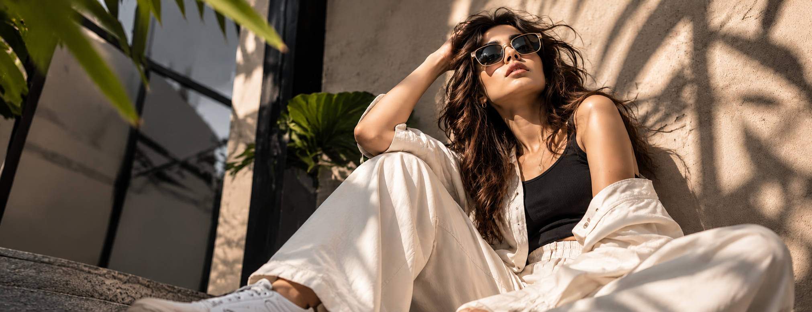
</p>

---

## 🧵 The Craft & Material Philosophy

At the core of Aveez Fashion is an obsessive dedication to fabric engineering:

- **450 GSM French Terry Cotton:** Custom-milled, luxury brushed interior for substantial body, structured drop shoulders, and seamless double-layered hoods.
- **280 GSM Combed Single Jersey:** High-density single-jersey combed cotton with high-tension 1.25" rib knit collars that maintain their structure without sagging.
- **Pre-Shrunk & Silicon Washed:** Pre-laundered for buttery hand-feel, zero post-purchase shrinkage, and long-term durability.
- **Tailored Modernity:** Pleated architectural trousers and structured overshirts built for effortless drape and contemporary movement.

---

## 🖤 Curated Collections

<table align="center" width="100%">
  <tr>
    <td width="50%" align="center">
      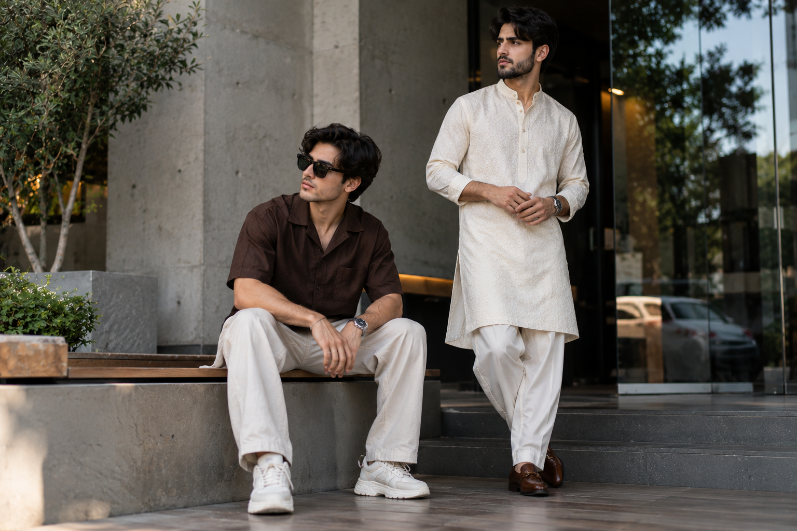
      <br/>
      <strong>MEN</strong>
      <br/>
      <em>Boxy silhouettes & heavyweight essentials</em>
    </td>
    <td width="50%" align="center">
      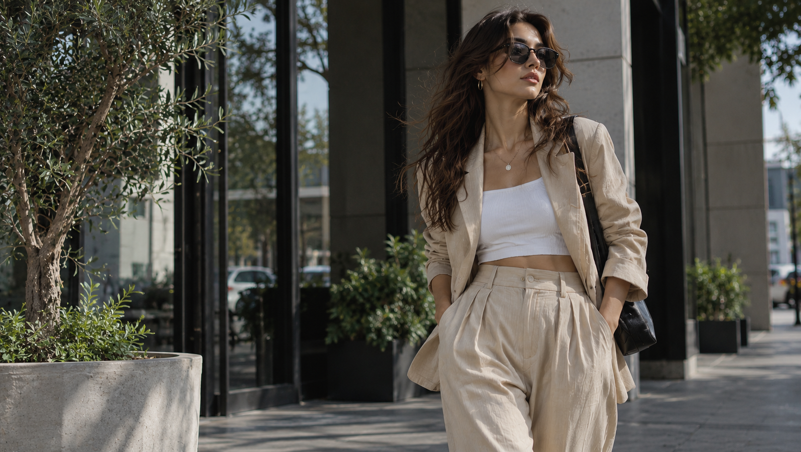
      <br/>
      <strong>WOMEN</strong>
      <br/>
      <em>Architectural tailoring & relaxed drapes</em>
    </td>
  </tr>
</table>

<table align="center" width="100%">
  <tr>
    <td width="25%" align="center">
      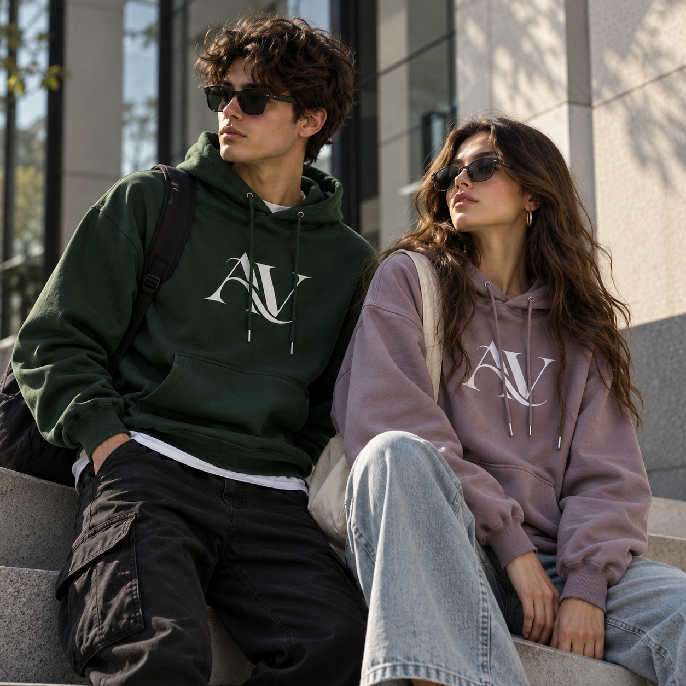
      <br/>
      <strong>HOODIES</strong>
      <br/>
      <sub>450 GSM French Terry</sub>
    </td>
    <td width="25%" align="center">
      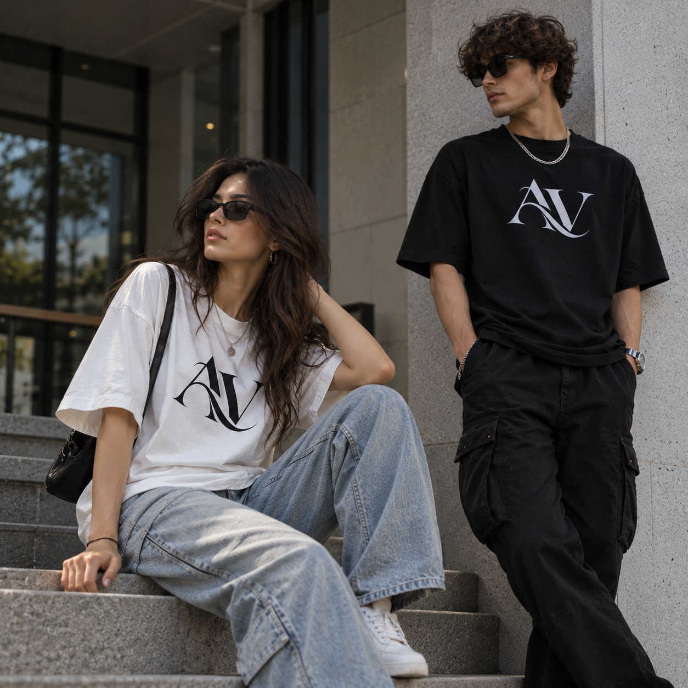
      <br/>
      <strong>OVERSIZED TEES</strong>
      <br/>
      <sub>280 GSM Combed Jersey</sub>
    </td>
    <td width="25%" align="center">
      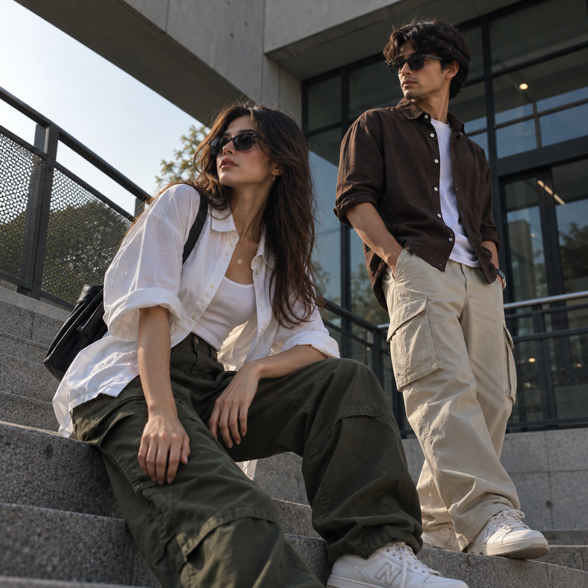
      <br/>
      <strong>BOTTOMS</strong>
      <br/>
      <sub>Pleated Wide-Leg Pants</sub>
    </td>
    <td width="25%" align="center">
      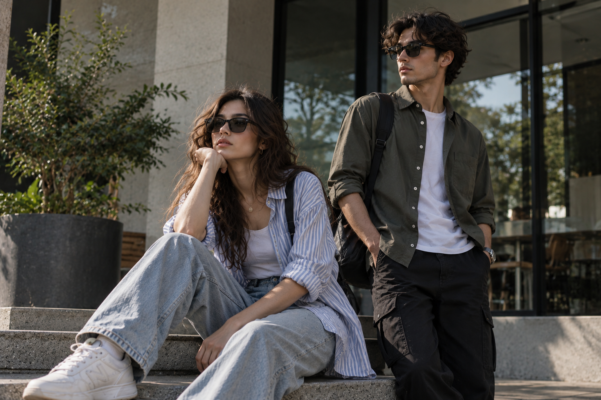
      <br/>
      <strong>SHIRTS</strong>
      <br/>
      <sub>Cuban Collar & Overshirts</sub>
    </td>
  </tr>
</table>

---

## ✨ "Together in Style" — Coordinated Pairs

*Two styles. One connection.* A dedicated high-fashion capsule celebrating coordinated couple styling across traditional, streetwear, and lounging contexts.

<table align="center" width="100%">
  <tr>
    <td width="25%" align="center">
      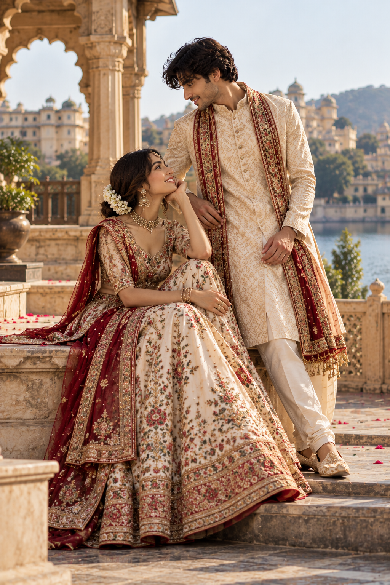
      <br/>
      <strong>ROYAL PAIR</strong>
      <br/>
      <sub>Poshak & Kurta Pajama</sub>
    </td>
    <td width="25%" align="center">
      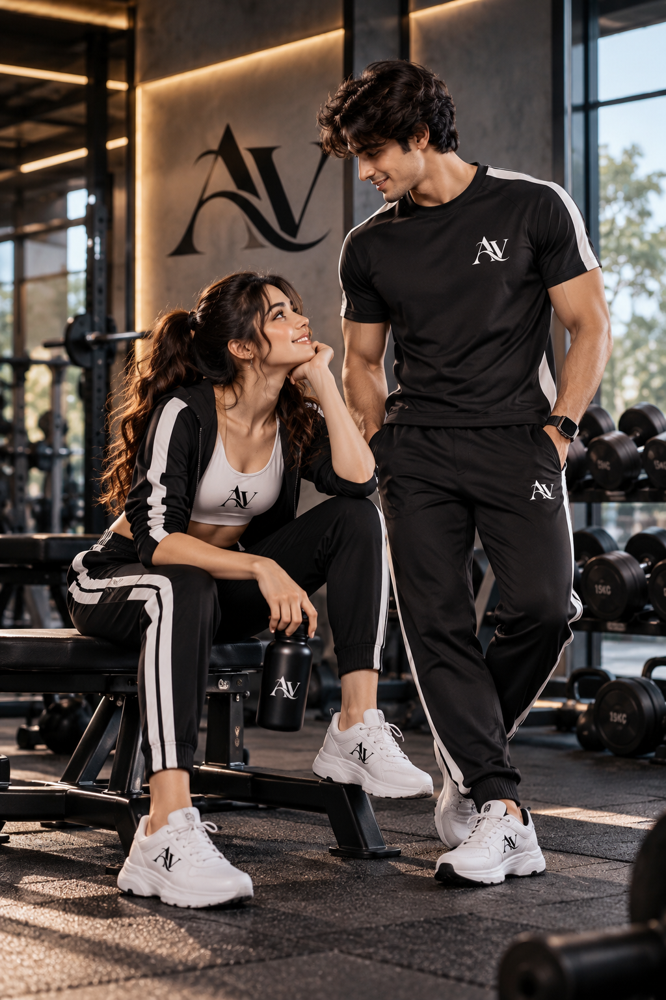
      <br/>
      <strong>SPORT TOGETHER</strong>
      <br/>
      <sub>Matching Sportswear</sub>
    </td>
    <td width="25%" align="center">
      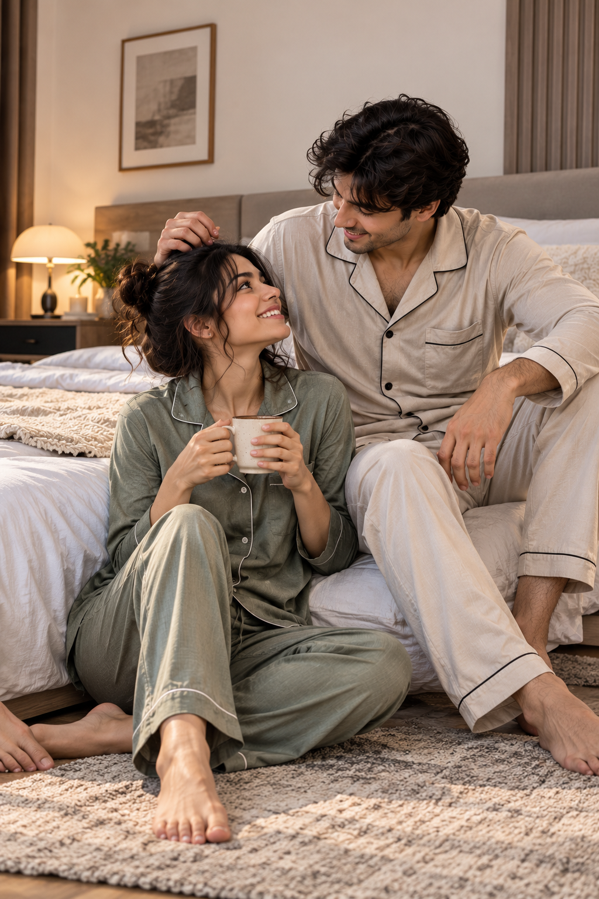
      <br/>
      <strong>NIGHT IN</strong>
      <br/>
      <sub>Matching Nightwear</sub>
    </td>
    <td width="25%" align="center">
      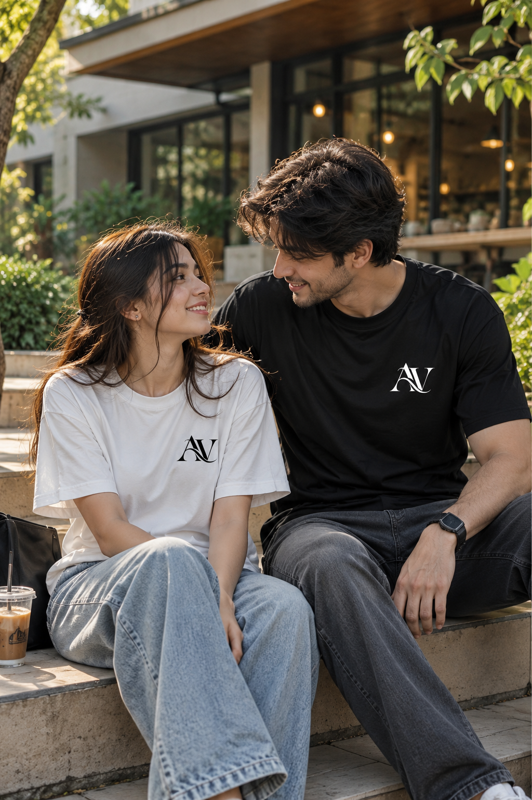
      <br/>
      <strong>MADE FOR TWO</strong>
      <br/>
      <sub>Couple T-Shirts</sub>
    </td>
  </tr>
</table>

---

## ⚡ Storefront Experience & Key Features

- **Single-Line Interactive Showcase:** Smooth horizontal product slider for New Arrivals with smooth touch swipe and desktop drag navigation.
- **Persistent Luxury Shopping Bag:** Seamless slide-out cart drawer with instant size modification, real-time totals, and free-shipping progress indicators.
- **Wishlist & Curated Favorites:** One-tap save functionality with immediate state synchronization across pages.
- **Multi-Facet Catalog Discovery:** Instant filtering by Category, Gender, Fit, Size, and Price on the Product Listing Page.
- **Zero-Trust Pricing Architecture:** Server-authoritative calculation of item costs, applied discounts, and checkout totals to prevent client tampering.
- **Pure Design Token System:** Built exclusively with vanilla CSS custom properties without third-party utility dependencies, ensuring pristine styling performance and ultra-fast page speeds.

---

## 🛠️ Getting Started

### Prerequisites

- Node.js 18.17+ or 20+
- npm or yarn

### Installation & Run

```bash
# Clone the repository
git clone https://github.com/lwavee/aveezfashion.git

# Navigate to project directory
cd aveezfashion

# Install dependencies
npm install

# Start local development server
npm run dev
```

Open [http://localhost:3000](http://localhost:3000) (or the port specified in terminal) to view the storefront.

### Production Build

```bash
# Compile and optimize production bundle
npm run build

# Start production server
npm run start
```

---

## 🏷️ Brand & Intellectual Property

<p align="center">
  
</p>

All brand marks, logos, typographies, photography, garment designs, and trademarks are the proprietary intellectual property of **AVEEZ FASHION**.

*"Wear Different."* • Crafted with pride in India.
