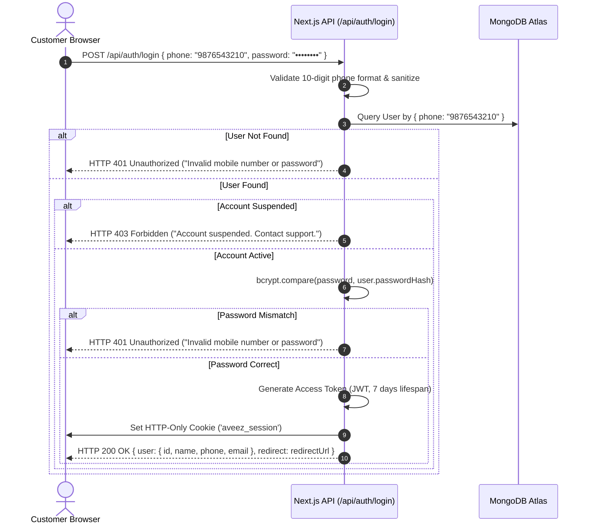
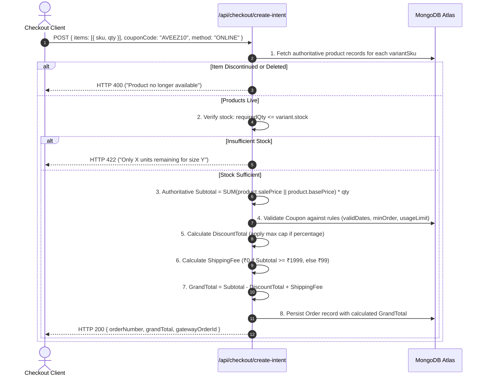
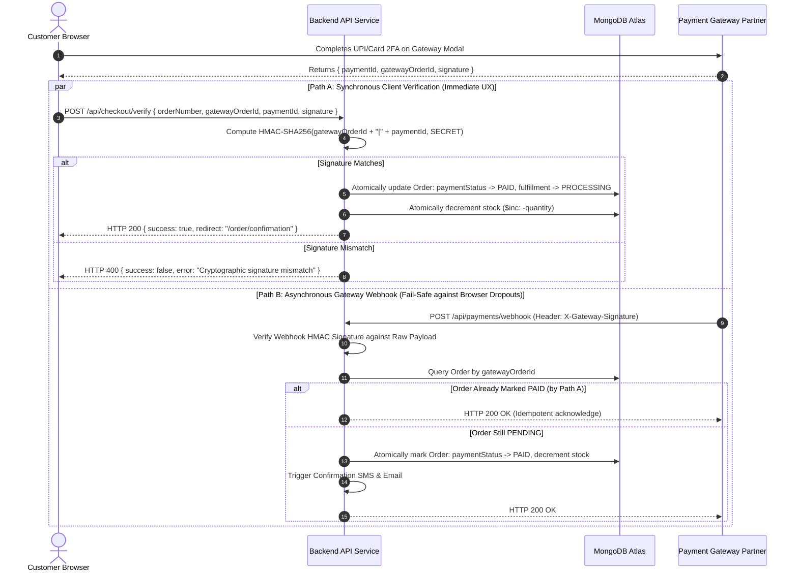
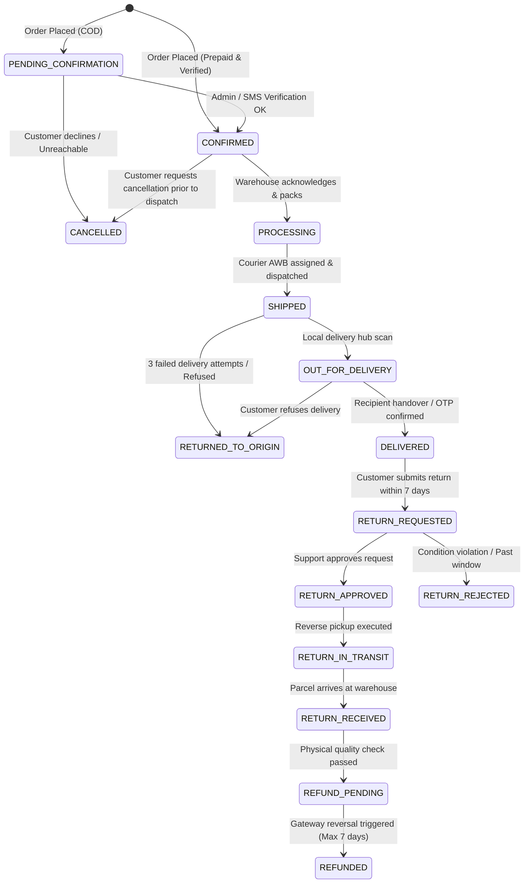
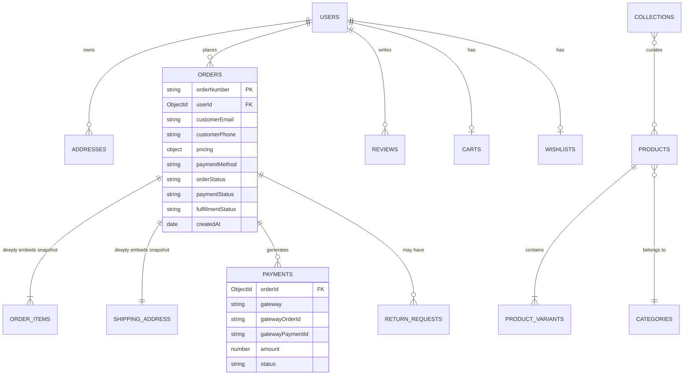

# AVEEZ FASHION — MASTER E-COMMERCE WORKFLOW SPECIFICATION

**Document Version:** 1.0.0  
**Status:** Living Master Specification / Architectural Blueprint  
**Target Environment:** Next.js 14+ (App Router), Node.js, MongoDB 7.0+ (Mongoose 8+)  
**Brand Identity:** Aveez Fashion — Contemporary Luxury Streetwear & Apparel  
**Production Domain:** `https://aveezfashion.com`  
**Related Architecture Documents:**
* [Project Architecture](file:///e:/Aveezfashion/docs/PROJECT_ARCHITECTURE.md)
* [Database Schema](file:///e:/Aveezfashion/docs/DATABASE_SCHEMA.md)
* [REST API Specification](file:///e:/Aveezfashion/docs/API_SPECIFICATION.md)
* [Payment & Settlement Architecture](file:///e:/Aveezfashion/docs/PAYMENT_ARCHITECTURE.md)
* [Security Architecture](file:///e:/Aveezfashion/docs/SECURITY_ARCHITECTURE.md)
* [Development Roadmap](file:///e:/Aveezfashion/docs/DEVELOPMENT_ROADMAP.md)
* [Testing Strategy](file:///e:/Aveezfashion/docs/TESTING_STRATEGY.md)
* [UI Design System](file:///e:/Aveezfashion/docs/UI_DESIGN_SYSTEM.md)
* [SEO Architecture](file:///e:/Aveezfashion/docs/SEO_ARCHITECTURE.md)

---

## Document Purpose & Architectural Charter

This master specification serves as the **single authoritative functional workflow reference** for Aveez Fashion. It establishes the end-to-end operational logic connecting all customer-facing storefront pages, administrative back-office cockpits, REST API contracts, MongoDB persistence models, and third-party integrations (payment gateways, SMS providers, logistics couriers).

This document explicitly bridges the gap between:
1. **Existing Baseline Implementation:** What is currently active in the workspace code.
2. **Documented Phase 0 Blueprints:** What was previously outlined in early documentation.
3. **Target Production Workflows:** The cohesive, robust, and customer-first workflows required for launch.

---

## Table of Contents

1. [Executive Codebase Audit & Gap Analysis](#1-executive-codebase-audit--gap-analysis)
2. [End-to-End Customer Journey](#2-end-to-end-customer-journey)
3. [Authentication, OTP & Account Management](#3-authentication-otp--account-management)
4. [Address Book & Seamless Checkout Experience](#4-address-book--seamless-checkout-experience)
5. [Cart Lifecycle & Server-Authoritative Pricing](#5-cart-lifecycle--server-authoritative-pricing)
6. [Payment Gateway & Order Creation Engine](#6-payment-gateway--order-creation-engine)
7. [Admin Panel & Back-Office Order Management](#7-admin-panel--back-office-order-management)
8. [Decoupled Order Status State Machine](#8-decoupled-order-status-state-machine)
9. [Track Your Order & Real-Time Telemetry](#9-track-your-order--real-time-telemetry)
10. [Customer Account Dashboard & Order History](#10-customer-account-dashboard--order-history)
11. [Returns & Exchanges Lifecycle](#11-returns--exchanges-lifecycle)
12. [Refund Processing & 7-Calendar-Day Guarantee](#12-refund-processing--7-calendar-day-guarantee)
13. [Shipping, Courier Logistics & Delivery](#13-shipping-courier-logistics--delivery)
14. [Omnichannel Notification Engine](#14-omnichannel-notification-engine)
15. [MongoDB Data Architecture & Immutability Patterns](#15-mongodb-data-architecture--immutability-patterns)
16. [REST API Integration Matrix](#16-rest-api-integration-matrix)
17. [Security, Privacy & DPDP Act 2023 Compliance](#17-security-privacy--dpdp-act-2023-compliance)
18. [UI & Page Integration Matrix](#18-ui--page-integration-matrix)
19. [Edge Cases & Resilient Error Handling Matrix](#19-edge-cases--resilient-error-handling-matrix)
20. [Comprehensive Testing Strategy & Acceptance Criteria](#20-comprehensive-testing-strategy--acceptance-criteria)
21. [Phased Development Roadmap](#21-phased-development-roadmap)
22. [Recommended Specialized Documentation](#22-recommended-specialized-documentation)

---

## 1. Executive Codebase Audit & Gap Analysis

An exhaustive audit of the existing codebase (`e:\Aveezfashion\src`) was conducted to evaluate current implementation realities against early Phase 0 documentation:

### 1.1 Implementation Status Matrix

| Subsystem / Feature | Implementation Reality in Codebase | Phase 0 Documentation Status | Workflow Status & Architectural Verdict |
| :--- | :--- | :--- | :--- |
| **Storefront Catalog** | Next.js App Router (`/`, `/shop`, `/product/[slug]`, `/collections`) with SSR/ISR seed fallback | Documented in `PROJECT_ARCHITECTURE.md` | **Fully Functional Baseline.** Catalog queries live MongoDB with static fallback. |
| **Shopping Cart** | `CartContext.tsx` with client-side `localStorage ('aveez_cart')` persistence | Documented in `DATABASE_SCHEMA.md` as server collection | **Partially Implemented.** Ephemeral local cart works; lacks server-side guest/auth sync. |
| **Customer Auth** | Email + Password JWT in `aveez_session` cookie (`/api/auth/login`, `/api/auth/register`) | Documented in `API_SPECIFICATION.md` as Email + Password | **Conflict Identified.** Code uses email+password; Target workflow requires **Mobile + Password with Mobile OTP verification**. |
| **Address Management** | Flat inline input fields on `/checkout`; single `defaultShippingAddress` in `User.ts` | Documented in `DATABASE_SCHEMA.md` as decoupled collection | **Gap Identified.** No address book, modal, or multi-address selection on checkout. |
| **Checkout Intent** | `POST /api/checkout/create-intent` recalculates item prices; creates `Order` in DB | Documented in `PAYMENT_ARCHITECTURE.md` | **Operational.** Implements zero-client-trust price recalculation and order creation. |
| **Online Payments** | Razorpay-compatible HMAC-SHA256 signature verification in `/api/checkout/verify` | Documented in `PAYMENT_ARCHITECTURE.md` | **Operational.** Validates signature; decreases stock atomically on success. |
| **Cash on Delivery (COD)** | Supported in checkout enum (`COD`); sets order status to `PENDING` | Documented in `PAYMENT_ARCHITECTURE.md` | **Operational Baseline.** Lacks manual phone confirmation admin workflow. |
| **Customer Dashboard** | Mock view at `/account` displaying hardcoded orders and profile | Documented in `PROJECT_ARCHITECTURE.md` | **UI Prototype Only.** Needs live backend API wiring to fetch customer orders. |
| **Admin Cockpit** | Static executive overview at `/admin` with mock metrics and orders queue | Documented in `PROJECT_ARCHITECTURE.md` | **UI Prototype Only.** Needs real API queries, role authorization, and state controls. |
| **Contact Support** | Live `/contact` page with `/api/contact` API endpoint and `ContactInquiry` DB model | Implemented in recent phase | **Fully Operational.** Stores inquiries, assigns reference ID, rate limited. |
| **Legal & Policy Pages** | `/privacy-policy`, `/terms-of-service`, `/refund-policy` live and accessible | Required for compliance | **Fully Operational.** 7-day refund commitment prominently published. |
| **Returns & Exchanges** | Footer links to `/returns-policy`; policy terms described in legal docs | Documented conceptually | **Missing.** Dedicated request portal and admin approval workflow not built. |

### 1.2 Core Architectural Conflicts & Resolution Strategy

1. **Authentication Conflict (Email vs. Mobile Number):**
   * *Existing Code:* Users register with `firstName`, `lastName`, `email`, `phone`, `password`; login requires `email` + `password`.
   * *Required Workflow:* Customers must register with **Full Name, Mobile Number, Email, Password**, verified via **Mobile OTP**. Login must be **Mobile Number + Password**.
   * *Resolution Strategy:* Upgrade the `User` schema to make `phone` a unique indexed required field; maintain `email` as a unique contact field; add `isPhoneVerified: Boolean`; implement an SMS OTP gateway provider abstraction.
2. **Address Management Gap:**
   * *Existing Code:* Checkout collects address as transient form inputs and embeds it in the `Order` record.
   * *Required Workflow:* Multi-address Address Book with a default address and an interactive **Change Address Modal** at checkout.
   * *Resolution Strategy:* Introduce a dedicated `Address` collection referenced by `User`; provide CRUD APIs; retain deep frozen address snapshot inside `Order` upon checkout.
3. **Order State Model Simplification:**
   * *Existing Code:* Merges order states into `paymentStatus` and `fulfillmentStatus`.
   * *Required Workflow:* Decouple into 5 clear state vectors: **Order Status**, **Payment Status**, **Fulfillment Status**, **Return/Exchange Status**, and **Refund Status**.

---

## 2. End-to-End Customer Journey

The Aveez Fashion customer journey prioritizes high conversion, minimal friction, visual elegance, and absolute financial clarity.

```mermaid
flowchart TD
    A[Visitor Lands on aveezfashion.com] --> B[Browse Catalog, Lookbooks & Drops]
    B --> C[Select Garment, Color & Size Variant]
    C --> D[Add Item to Shopping Cart]
    D --> E[Review Cart Drawer & Thresholds]
    E --> F{Proceed to Checkout}
    
    F -->|Authenticated Session| G[Fetch Saved Addresses]
    F -->|Unauthenticated Guest| H[Redirect to /login with redirect_url=/checkout]
    
    H --> I{Existing or New?}
    I -->|Existing Customer| J[Login: Mobile + Password]
    I -->|New Customer| K[Sign Up: Name, Mobile, Email, Pass]
    K --> L[Verify 6-Digit Mobile SMS OTP]
    L --> M[Account Activated]
    J --> N[Session Established via HTTP-Only JWT]
    M --> N
    
    N --> O[Preserve & Rehydrate Cart Items]
    O --> G
    
    G --> P{Has Saved Addresses?}
    P -->|Yes| Q[Display Default Address + 'Change' Modal]
    P -->|No| R[Present Inline Address Form & Save]
    
    Q --> S[Select Payment Method: Online or COD]
    R --> S
    
    S --> T[Backend Validates Stock, Prices & Address]
    T --> U{Payment Method Selection}
    
    U -->|Online Gateway| V[Create Gateway Order Intent]
    V --> W[Customer Authorizes via UPI / Card / NetBanking]
    W --> X[Server Cryptographic HMAC-SHA256 Verification]
    X -->|Valid| Y[Order Created: Status=CONFIRMED, Payment=PAID]
    X -->|Failed| Z[Payment Retried or Order Failed]
    
    U -->|Cash on Delivery| AA[Order Created: Status=PENDING_CONFIRMATION, Payment=PENDING]
    
    Y --> AB[Order Appears in Admin Panel Queue]
    AA --> AB
    
    AB --> AC{Order Type & Risk Review}
    AC -->|COD Orders| AD[Admin Phone Confirmation Call]
    AC -->|Prepaid Orders| AE[Auto/Admin Acknowledgment]
    
    AD -->|Customer Confirmed| AF[Order Status -> CONFIRMED]
    AD -->|Unreachable / Cancelled| AG[Order Status -> CANCELLED]
    AE --> AF
    
    AF --> AH[Warehouse Packing: Status -> PROCESSING / PACKED]
    AH --> AI[Courier Handover: Assign AWB Tracking Number]
    AI --> AJ[Status -> SHIPPED & SMS Notification Dispatched]
    AJ --> AK[Status -> OUT_FOR_DELIVERY]
    AK --> AL[Status -> DELIVERED]
    
    AL --> AM{Customer Post-Purchase Action}
    AM -->|Satisfied| AN[Completed Order]
    AM -->|Issue Reported within 7 Days| AO[Initiate Return / Exchange Request]
    AO --> AP[Admin Review -> Reverse Pickup -> Refund in Max 7 Days]
```



---

## 3. Authentication, OTP & Account Management

### 3.1 Sign Up Workflow (Mobile OTP Verification)

The registration workflow enforces verified mobile numbers to eradicate fake COD accounts, minimize Return-to-Origin (RTO) overhead, and enable direct WhatsApp/SMS order notifications.

```
┌────────────────────────────────────────────────────────────────────────┐
│                      CUSTOMER SIGN UP WORKFLOW                         │
├────────────────────────────────────────────────────────────────────────┤
│ 1. FORM INPUT: Full Name, Mobile (10-digit), Email Address, Password   │
│ 2. CLIENT VALIDATION: Mobile (regex ^[6-9]\d{9}$), Password (min 8)   │
│ 3. API SUBMISSION: POST /api/auth/register-initiate                    │
│ 4. SERVER CHECKS: Check duplicate phone/email in MongoDB               │
│ 5. OTP GENERATION: Cryptographic 6-digit numeric token                 │
│ 6. SMS DISPATCH: Transmitted via SMS Provider (DLT-approved in India)  │
│ 7. OTP STORAGE: Saved in ephemeral auth collection with 10-min TTL     │
│ 8. OTP VERIFICATION: POST /api/auth/verify-otp { phone, otp }          │
│ 9. USER CREATION: bcrypt hash (cost 12), isPhoneVerified=true          │
│ 10. SESSION ESTABLISHED: Signed JWT set in HTTP-Only secure cookie     │
└────────────────────────────────────────────────────────────────────────┘
```

#### Field Specifications & Validation Rules
* **Full Name:** Required, trimmed, min 2 characters, max 100 characters. Automatically parsed into `firstName` and `lastName`.
* **Mobile Number:** Required, exactly 10 digits starting with 6, 7, 8, or 9 (Indian telecom standard `^[6-9]\d{9}$`). Indexed uniquely in MongoDB.
* **Email Address:** Required, standard RFC 5322 regex validation, normalized to lowercase, trimmed. Unique index.
* **Password:** Required, minimum 8 characters, at least one uppercase letter, one digit, and one special character. Encrypted with `bcryptjs` using 12 salt rounds.

#### OTP Security, Expiry & Rate Limiting Specifications
* **Token Complexity:** 6-digit cryptographic pseudo-random number (`100000` to `999999`).
* **Validity Period:** Exactly **10 minutes (600 seconds)** from issuance.
* **Single-Use Enforcement:** The OTP record is deleted immediately upon successful verification.
* **Attempt Ceiling:** Maximum **3 incorrect verification attempts** per OTP. On the 4th failed attempt, the OTP is invalidated, requiring a fresh request.
* **Resend Cooldown:** Minimum **60 seconds cooldown** between resend requests.
* **Daily Velocity Limit:** Maximum **5 OTP requests per mobile number per 24-hour window** to prevent SMS toll fraud.
* **SMS Provider Status:** *Operational Gap.* Codebase currently uses email-password auth. SMS Gateway credentials (e.g., MSG91, Gupshup, or Twilio) and DLT registration templates must be provisioned in `.env.local`.

---

### 3.2 Login Workflow (Mobile Number + Password)



#### Security Guardrails:
* **Generic Error Messages:** Always return `"Invalid mobile number or password"` to prevent phone number enumeration attacks.
* **Brute-Force Protection:** Rate limit login attempts to max 5 failed requests per IP/mobile per 15-minute window.
* **Session Persistence:** Authenticated token is signed with `JWT_SECRET` and stored in an `HttpOnly`, `SameSite=Lax`, `Secure` (production) cookie named `aveez_session`.
* **Redirect Parameter Preservation:** When redirected from checkout, the URL retains `?redirect=/checkout`. Upon successful login, the client redirects back to checkout without dropping cart state.

---

### 3.3 Forgot Password Workflow (Mobile OTP Reset)

1. **Step 1 — Request:** Customer enters their registered 10-digit mobile number at `/forgot-password`.
2. **Step 2 — Account Lookup:** Backend checks MongoDB for the account. To prevent enumeration, the API responds with a generic message: `"If an account is associated with this number, an OTP has been sent."`
3. **Step 3 — OTP Dispatch:** A 6-digit OTP with a 10-minute validity is dispatched via SMS.
4. **Step 4 — Verification:** Customer enters the OTP. Upon validation, the server generates a short-lived single-use **Password Reset Token** (valid for 15 minutes).
5. **Step 5 — New Password Submission:** Customer submits the new password along with the reset token.
6. **Step 6 — Re-hashing & Invalidation:** The password is re-hashed with `bcrypt` (12 rounds). The `tokenVersion` counter on the `User` document increments by 1, instantly terminating any existing active sessions across all devices.

---

### 3.4 Admin Authentication & Role Authorization

Administrative access is strictly decoupled from customer accounts:
* **Dedicated Route:** `/admin/login` (separate from customer `/login`).
* **Role-Based Access Control (RBAC):** Roles include `SUPER_ADMIN`, `STORE_MANAGER`, `ORDER_OPERATOR`, and `SUPPORT_AGENT`.
* **API Protection:** Admin APIs (`/api/admin/*`) validate both the JWT session and verify that `user.role !== 'CUSTOMER'`.
* **Data Isolation:** Customer APIs cannot access administrative operational data; customers can only query records where `order.user === authenticatedUserId`.

---

## 4. Address Book & Seamless Checkout Experience

### 4.1 Address Data Structure & Validation

Addresses are stored in a dedicated `addresses` collection and reference the parent `User`:

```typescript
export interface AddressDocument {
  _id: string;
  userId: string; // Ref: 'User'
  fullName: string; // Recipient full name (min 2, max 100)
  phone: string; // Recipient phone (10-digit Indian mobile)
  houseBuilding: string; // Flat, House No., Building, Apartment
  streetArea: string; // Street, Colony, Locality, Sector
  landmark?: string; // Optional landmark
  pincode: string; // 6-digit Indian Postal PIN Code (regex: ^[1-9][0-9]{5}$)
  city: string; // City / District
  state: string; // Indian State / Union Territory
  addressType: 'HOME' | 'WORK' | 'OTHER';
  isDefault: boolean; // Flag indicating customer default
  createdAt: Date;
  updatedAt: Date;
}
```

---

### 4.2 Authenticated Checkout Flow & Address Selection

When an authenticated customer visits `/checkout`:

1. **Auto-Rehydration:** The client fetches the customer's saved addresses via `GET /api/user/addresses`.
2. **Default Address Selection:**
   * If a saved address with `isDefault: true` exists, it is automatically pre-selected.
   * The address is prominently displayed in a clean card format:
     ```
     DELIVER TO: Arjun Mehta (+91 98765 43210)
     Flat 402, Skyline Residency, MG Road, Landmark: Near Metro Station
     Bengaluru, Karnataka — 560001 [HOME]
     [CHANGE ADDRESS BUTTON]
     ```
3. **Change Address Modal Interaction:**
   When the customer clicks **Change Address**, a modal opens:
   * **List View:** Displays all saved addresses for the customer with radio selection controls.
   * **Visual Indicator:** The currently selected checkout address is clearly highlighted with a black border and badge.
   * **Edit Action:** Each card has an **Edit** button. Clicking it transitions the modal view into a pre-filled edit form. Saving updates the record in MongoDB via `PUT /api/user/addresses/:id` and updates the active selection.
   * **Add New Address Action:** An **+ Add New Address** button opens a blank address form. Saving persists it to the user's address book and automatically selects it for the current order.
   * **Set as Default:** Checkbox allows the customer to promote the address to `isDefault: true`.

---

### 4.3 First-Time Customer Flow (No Saved Addresses)

If a customer has zero saved addresses:
1. The checkout page displays the clean address form inline.
2. Form fields are validated on both client and server:
   * Recipient Full Name
   * 10-digit Mobile Number
   * House / Building / Flat
   * Street / Area
   * Landmark (Optional)
   * PIN Code (6 digits)
   * City & State
   * Address Type (`HOME`, `WORK`, `OTHER`)
3. A checkbox `[✓] Save this address to my account` is checked by default.
4. Upon clicking **Continue to Payment**, the address is saved to MongoDB and selected.

---

### 4.4 Immutable Order Address Snapshot Pattern

> **CRITICAL LEGAL RULE:** Customer address book records are **never referenced by raw `ObjectId` alone** in placed orders.

When an order is created, the selected address is **deeply cloned and embedded as an immutable snapshot** inside `orders.shippingAddress`. If the customer later moves, edits, or deletes the address in their address book, historical tax invoices, dispatch labels, and audit logs remain unchanged and legally accurate.

---

## 5. Cart Lifecycle & Server-Authoritative Pricing

### 5.1 Cart Operations & Persistence

```
┌────────────────────────────────────────────────────────────────────────┐
│                        CART LIFECYCLE MODEL                            │
├────────────────────────────────────────────────────────────────────────┤
│ GUEST BROWSING:                                                        │
│ • Cart items stored in browser localStorage ('aveez_cart')             │
│ • Allows frictionless browsing without forcing registration            │
│                                                                        │
│ LOGIN / SIGN-UP MERGE EVENT:                                           │
│ • When customer logs in, local items synchronize to MongoDB 'carts'    │
│ • Merging combines matching variant SKUs by summing quantities         │
│ • Submits merged cart to server; re-validates live stock availability  │
│                                                                        │
│ LOGGED-IN BROWSING:                                                    │
│ • Changes immediately sync to both localStorage and MongoDB collection│
│ • Cart persists across devices (desktop to mobile)                     │
└────────────────────────────────────────────────────────────────────────┘
```

---

### 5.2 Zero-Client-Trust Financial Recalculation

Under the Aveez Fashion security architecture, **client-submitted prices, discounts, and totals are treated as completely untrusted**. The frontend only transmits:
* Array of `{ variantSku: string, quantity: number }`
* Delivery pincode
* Optional coupon code string
* Payment method string



---

### 5.3 Shipping & Tax Rules
* **Free Express Shipping Threshold:** **₹1,999** order subtotal.
* **Standard Shipping Fee:** **₹99 flat fee** for orders below ₹1,999.
* **Goods and Services Tax (GST):** Product prices displayed on the storefront are **inclusive of 12% apparel GST**, as clearly designated in checkout line items.

---

## 6. Payment Gateway & Order Creation Engine

### 6.1 Supported Payment Methods
1. **Online Payment Gateway (Razorpay / Cashfree Rails):**
   * **UPI:** Google Pay, PhonePe, Paytm, BHIM, and bank UPI apps.
   * **Cards:** Visa, MasterCard, RuPay, and American Express with mandatory RBI 2FA OTP.
   * **Net Banking:** 50+ Indian commercial banks.
2. **Cash on Delivery (COD):**
   * Available for serviceable pin codes.
   * Subject to phone verification workflow prior to warehouse dispatch.

---

### 6.2 Dual-Track Payment Verification (Sync Verification + Webhook Fail-Safe)

To prevent phantom orders and race conditions, the system uses a dual-track verification pattern:



---

### 6.3 COD Manual Confirmation Workflow

For Cash on Delivery orders, order confirmation follows an explicit operational validation process to mitigate RTO (Return-to-Origin) freight losses:

1. **Order Creation:** Customer submits COD checkout. Order is created with:
   * `paymentMethod: 'COD'`
   * `paymentStatus: 'UNPAID'`
   * `orderStatus: 'PENDING_CONFIRMATION'`
   * `fulfillmentStatus: 'UNFULFILLED'`
2. **Admin Queue Ingestion:** The order immediately populates the **COD Verification Queue** in the Admin Panel.
3. **Customer Contact Protocol:**
   * Support agent reviews customer delivery history and contacts the recipient via verified phone call or automated WhatsApp confirmation interactive button.
4. **Outcome Recording:**
   * **Confirmed:** Admin clicks **Confirm Order**. `orderStatus` transitions to `CONFIRMED`; warehouse packing ticket is generated.
   * **Customer Requested Cancellation:** Admin records cancellation reason; order transitions to `CANCELLED`; inventory reservations are released.
   * **Unreachable (3 Attempts over 24h):** Order transitions to `CANCELLED_UNREACHABLE`.

---

## 7. Admin Panel & Back-Office Order Management

### 7.1 Admin Order List Specification
The Order Management screen provides real-time visibility across all transaction lifecycles:

* **Filters:**
  * Order Status (`ALL`, `PENDING_CONFIRMATION`, `CONFIRMED`, `PROCESSING`, `SHIPPED`, `DELIVERED`, `CANCELLED`, `RETURN_REQUESTED`, `REFUNDED`)
  * Payment Method (`ALL`, `ONLINE_GATEWAY`, `COD`)
  * Payment Status (`PAID`, `PENDING`, `FAILED`, `REFUNDED`)
  * Date Range Picker
* **Search:** Multi-field live search across Order ID, Customer Name, Mobile Number, and Courier AWB Tracking Number.
* **Table Columns:**
  1. `Order Number` (Clickable link to details)
  2. `Timestamp` (Formatted: `DD MMM YYYY, HH:mm`)
  3. `Customer Name & Mobile`
  4. `Items Summary` (e.g., "Signature Hoodie (L) × 1")
  5. `Grand Total` (in INR, e.g., ₹3,499)
  6. `Payment Method & Status Badge` (e.g., `PAID (UPI)` in green)
  7. `Order Lifecycle Status Badge`
  8. `Courier & AWB` (e.g., "BlueDart — 39182410" or "Unassigned")
  9. `Quick Actions` (View, Confirm, Dispatch)

---

### 7.2 Admin Order Details Cockpit

The detail view provides complete audit capabilities:
* **Customer Profile Snapshot:** Name, verified mobile, email, total lifetime orders, RTO risk score.
* **Immutable Delivery Address Snapshot:** Recipient, address, landmark, PIN, city, state.
* **Line Items Breakdown:** Product thumbnails, titles, variant SKUs, size, color, unit price, quantity, line total.
* **Financial Ledger:** Subtotal, coupon applied, discounts, shipping fee, tax breakdown, grand total, gateway transaction ID, payment status.
* **Customer Confirmation Audit Trail:** Internal notes recording who verified the order, timestamp, and call outcomes.
* **Logistics & Dispatch Box:** Form to select carrier partner (BlueDart, Delhivery, ExpressBees, DTDC), enter tracking number, and generate shipping manifest.
* **Return & Refund Action Controls:** Approve/reject return requests, record received goods condition, trigger gateway refunds.

---

## 8. Decoupled Order Status State Machine

To eliminate ambiguity, Aveez Fashion strictly decouples e-commerce state into **five orthogonal state concepts**:

```
┌────────────────────────────────────────────────────────────────────────┐
│                     DECOUPLED ORDER STATE VECTORS                      │
├────────────────────┬───────────────────────────────────────────────────┤
│ State Vector       │ Allowed Enumerations                              │
├────────────────────┼───────────────────────────────────────────────────┤
│ 1. Order Status    │ PENDING_CONFIRMATION, CONFIRMED, PROCESSING,      │
│                    │ SHIPPED, OUT_FOR_DELIVERY, DELIVERED, CANCELLED   │
├────────────────────┼───────────────────────────────────────────────────┤
│ 2. Payment Status  │ UNPAID, PENDING, PAID, FAILED, REFUNDED           │
├────────────────────┼───────────────────────────────────────────────────┤
│ 3. Fulfillment     │ UNFULFILLED, PACKED, DISPATCHED, DELIVERED,       │
│    Status          │ RETURNED_TO_ORIGIN                                │
├────────────────────┼───────────────────────────────────────────────────┤
│ 4. Return/Exchange │ NONE, REQUESTED, APPROVED, REJECTED,              │
│    Status          │ PICKUP_SCHEDULED, IN_TRANSIT, RECEIVED, COMPLETED │
├────────────────────┼───────────────────────────────────────────────────┤
│ 5. Refund Status   │ NONE, PENDING, INITIATED, PROCESSED, FAILED       │
└────────────────────┴───────────────────────────────────────────────────┘
```

---

### 8.1 State Transition Matrix



#### Status Transition Rules & Permissions
| Current State | Permitted Next States | Trigger Actor | Required Payload Data | Customer Notification |
| :--- | :--- | :--- | :--- | :--- |
| `PENDING_CONFIRMATION` | `CONFIRMED`, `CANCELLED` | Admin / System | Admin ID, verification note | SMS & Email |
| `CONFIRMED` | `PROCESSING`, `CANCELLED` | Admin / Warehouse | Admin ID, batch ID | In-Account Status |
| `PROCESSING` | `SHIPPED`, `CANCELLED` | Admin / Fulfillment | Carrier Name, Tracking AWB, Tracking URL | SMS with Tracking Link |
| `SHIPPED` | `OUT_FOR_DELIVERY`, `RTO` | Courier Webhook / Admin | Courier event timestamp | SMS Alert |
| `OUT_FOR_DELIVERY` | `DELIVERED`, `RTO` | Courier Webhook / Admin | Proof of delivery, handover timestamp | Delivery Confirmation SMS |
| `DELIVERED` | `RETURN_REQUESTED` | Customer | Order Item, Reason, Photo Evidence | Request Acknowledged Email |
| `RETURN_REQUESTED` | `RETURN_APPROVED`, `REJECTED` | Support Admin | Approval decision, rejection notes | Email with Decision |
| `RETURN_APPROVED` | `RETURN_IN_TRANSIT` | Logistics Carrier | Reverse AWB tracking number | Reverse Pickup SMS |
| `RETURN_RECEIVED` | `REFUND_PENDING` | Quality Control Admin | Inspection check results (unworn/tags) | Inspection Passed Email |
| `REFUND_PENDING` | `REFUNDED` | System / Admin | Gateway Refund ID, Amount, Timestamp | Refund Processed Email & SMS |

---

## 9. Track Your Order & Real-Time Telemetry

### 9.1 Authenticated Tracking Route (`/account` & `/order/track`)
* **Behavior:** When an authenticated user visits their order details, the system queries orders matching `{ _id: orderId, user: authenticatedUserId }`.
* **Visual Representation:** Renders a clean luxury vertical step timeline:
  1. `Order Confirmed` (Timestamp)
  2. `Packed & Prepared at Studio` (Timestamp)
  3. `Dispatched via [Carrier Name]` (Tracking Number + Clickable Link)
  4. `Out for Delivery` (Local delivery hub status)
  5. `Delivered` (Estimated or completed date)

---

### 9.2 Secure Guest Order Lookup Route (`/track`)
To allow guest lookup without compromising customer privacy or exposing order details:
* **Lookup Inputs:** Requires **both** `Order Number` (e.g., `AVZ-2026-004812`) AND the registered `Mobile Number` or `Email Address`.
* **Security Guardrail:** Brute-force protected (max 5 lookup requests per minute per IP).
* **Data Minimization:** Displays order status timeline, delivery city, and items purchased, but **masks sensitive customer details** (e.g., "Arjun M*****" and "Flat 402, ******* Bengaluru").

---

## 10. Customer Account Dashboard & Order History

The `/account` dashboard acts as the unified customer control center:

```
┌────────────────────────────────────────────────────────────────────────┐
│                     MY ACCOUNT CUSTOMER DASHBOARD                      │
├────────────────────────────────────────────────────────────────────────┤
│ 1. PROFILE HEADER: Full Name, Verified Mobile Badge, Email             │
│ 2. SAVED ADDRESSES: Manage Address Book, Add New, Set Default          │
│ 3. ACTIVE ORDERS: Cards for orders in transit with live track button   │
│ 4. ORDER HISTORY: Paginated list of completed / past orders            │
│ 5. ORDER ACTIONS:                                                      │
│    • Cancel Order (Enabled only if status is PENDING or CONFIRMED)     │
│    • Download Invoice (PDF generation with GST breakdown)              │
│    • Request Return / Exchange (Enabled within 7 days of delivery)     │
│    • View Refund Status (Displays 7-day gateway progress)              │
└────────────────────────────────────────────────────────────────────────┘
```

---

## 11. Returns & Exchanges Lifecycle

### 11.1 Eligibility Criteria (Aligned with Terms of Service & Refund Policy)
* **Reporting Window:** Must be submitted within **7 calendar days of delivery**.
* **Eligible Conditions:**
  1. Damaged in transit or manufacturing defect (tears, broken hardware, faulty stitching).
  2. Incorrect item, color, or size delivered compared to order invoice.
  3. Size fit exchange (subject to inventory availability).
* **Mandatory Garment Condition:** Garments must be in original, unwashed, unworn condition with all brand tags, labels, and packaging intact.

---

### 11.2 End-to-End Request & Inspection Flow

```mermaid
sequenceDiagram
    autonumber
    actor Customer as Customer Dashboard
    participant API as Return Request API
    participant Admin as Admin Support Team
    participant WH as Warehouse QC Facility
    participant GW as Payment Gateway
    
    Customer->>API: POST /api/orders/:id/return-request { itemSku, reason, photos, requestType: "RETURN" }
    API->>API: Validate order delivery timestamp <= 7 days
    API-->>Customer: Return Request Created (Ref: RET-2026-0812)
    
    Admin->>Admin: Review photographic evidence in Admin Panel
    Admin->>API: Approve Request & Assign Reverse Courier Pickup
    API-->>Customer: Reverse Pickup Scheduled SMS with Courier Details
    
    Customer->>WH: Hand over packaged garment to courier executive
    WH->>WH: Inspect garment: check tags, verify unworn, no perfume/wash
    
    alt Inspection Failed (Worn / Tags Missing)
        WH->>Admin: Mark QC_REJECTED with inspection photos
        Admin-->>Customer: Rejection Notice; garment shipped back to customer
    else Inspection Passed
        WH->>Admin: Mark QC_PASSED
        alt Request Was Exchange
            Admin->>API: Generate new zero-value replacement order
            API-->>Customer: Replacement Dispatched Notification
        else Request Was Return
            Admin->>GW: Trigger Gateway Refund (Max 7 Calendar Days)
            GW-->>Customer: Funds Credited to Source Account
        end
    end
```

---

## 12. Refund Processing & 7-Calendar-Day Guarantee

### 12.1 The 7-Calendar-Day Binding Commitment

> **CORE PROMISE:** Once an eligible refund is approved (upon order cancellation or returned garment passing physical inspection), Aveez Fashion will **initiate and process the refund within a maximum of 7 calendar days**.

#### Transparent Multi-Stage Timeline Breakdown:
1. **Stage 1 — Return Receipt & Inspection (1–2 Days):** Return parcel arrives at fulfillment studio and undergoes physical verification.
2. **Stage 2 — Official Approval (24–48 Hours):** Written approval issued via email, establishing the start of the 7-day period.
3. **Stage 3 — Aveez Internal Initiation (Maximum 7 Calendar Days):** Aveez Fashion triggers the refund through the payment gateway API.
4. **Stage 4 — Bank & Card Settlement (Typically 3–7 Banking Days):** External banking networks process the credit to customer accounts (UPI usually settles within 24–48 hours; cards/netbanking take 3–7 banking days).

---

### 12.2 Refund Methods
* **Online Prepaid Orders:** Automatic reversal through the payment gateway back to the original source account (UPI VPA, card, or bank account).
* **Cash on Delivery (COD) Orders:** Refund issued via **NEFT Bank Transfer** or **Verified UPI** after the customer provides verified bank account details (Account Name, Number, IFSC, or UPI ID) through secure email or authenticated dashboard.

---

## 13. Shipping, Courier Logistics & Delivery

1. **Address Validation:** Pre-checkout PIN code validation verifies carrier serviceability.
2. **Picking & Packaging:** Orders are packed in custom luxury branded boxes with moisture-proof protection.
3. **Manifesting & Courier Assignment:** Admin assigns primary carrier (BlueDart, Delhivery, or regional express). System records carrier name, Air Waybill (AWB) number, and tracking URL.
4. **Status Webhooks:** Automated courier webhook integration updates order fulfillment status as parcels move from `PICKED_UP` to `IN_TRANSIT`, `OUT_FOR_DELIVERY`, and `DELIVERED`.
5. **Delivery Exceptions & RTO Protocol:** If delivery fails on Attempt 1, carrier re-attempts on consecutive days. After 3 failed attempts, parcel transitions to `RETURNED_TO_ORIGIN`.

---

## 14. Omnichannel Notification Engine

Customer confidence is maintained through clear transactional notifications:

| Trigger Event | Channel | Content Summary |
| :--- | :--- | :--- |
| **Sign Up OTP** | SMS | 6-digit verification code with 10-minute expiry warning. |
| **Order Placed (Prepaid)** | Email & SMS | Confirmation with Order ID, items summary, and invoice link. |
| **Order Placed (COD)** | SMS / WhatsApp | Acknowledgment stating team will call for dispatch confirmation. |
| **Order Confirmed** | Email & SMS | Notice that order has been accepted and sent to studio packing. |
| **Dispatched / Shipped** | SMS & Email | Courier name, live AWB tracking number, and track order URL. |
| **Out for Delivery** | SMS | Alert indicating courier executive is out for delivery today. |
| **Delivered** | Email & SMS | Delivery confirmation with link to review products. |
| **Return Approved** | Email | Reverse pickup instructions and preparation tips. |
| **Refund Initiated** | Email & SMS | Refund reference ID, amount, and 7-day timeline details. |

---

## 15. MongoDB Data Architecture & Immutability Patterns



---

## 16. REST API Integration Matrix

| Method | Endpoint Route | Description / Purpose | Auth Guard | Implementation Status |
| :--- | :--- | :--- | :--- | :--- |
| `POST` | `/api/auth/register-initiate` | Submits sign-up data, dispatches mobile OTP | Public | **Proposed (Target)** |
| `POST` | `/api/auth/verify-otp` | Validates mobile OTP, establishes session | Public | **Proposed (Target)** |
| `POST` | `/api/auth/login` | Mobile number + password authentication | Public | **Operational (Email-based; upgrade to phone)** |
| `POST` | `/api/auth/forgot-password-initiate`| Dispatches password reset OTP to mobile | Public | **Proposed (Target)** |
| `POST` | `/api/auth/forgot-password-verify`  | Validates OTP and sets new password | Public | **Proposed (Target)** |
| `GET`  | `/api/user/addresses` | Retrieves saved customer address book | Customer JWT | **Proposed (Target)** |
| `POST` | `/api/user/addresses` | Adds new address to address book | Customer JWT | **Proposed (Target)** |
| `PUT`  | `/api/user/addresses/:id` | Edits an existing saved address | Customer JWT | **Proposed (Target)** |
| `POST` | `/api/cart/sync` | Merges local guest cart with MongoDB | Customer JWT | **Proposed (Target)** |
| `POST` | `/api/checkout/create-intent` | Recalculates prices, creates Order intent | Public/Auth | **Operational** |
| `POST` | `/api/checkout/verify` | Verifies gateway HMAC signature | Public/Auth | **Operational** |
| `GET`  | `/api/orders/my-orders` | Retrieves customer order history | Customer JWT | **Proposed (Target)** |
| `GET`  | `/api/orders/:id` | Retrieves single order details | Customer JWT | **Proposed (Target)** |
| `POST` | `/api/orders/track-lookup` | Guest tracking via Order ID + Phone | Public | **Proposed (Target)** |
| `POST` | `/api/orders/:id/return-request` | Submits return or exchange request | Customer JWT | **Proposed (Target)** |
| `GET`  | `/api/admin/orders` | Retrieves paginated admin orders queue | Admin RBAC | **Proposed (Target)** |
| `PATCH`| `/api/admin/orders/:id/status` | Updates order state vectors & notes | Admin RBAC | **Proposed (Target)** |
| `POST` | `/api/admin/orders/:id/refund` | Initiates gateway refund | Admin RBAC | **Proposed (Target)** |
| `POST` | `/api/contact` | Submits customer support inquiry | Public | **Operational** |
| `POST` | `/api/newsletter` | Subscribes email to newsletter | Public | **Operational** |

---

## 17. Security, Privacy & DPDP Act 2023 Compliance

1. **Zero Client Trust:** All financial calculations (subtotals, discounts, taxes, shipping fees) take place strictly on the server.
2. **Session Protection:** Auth tokens are stored inside `HttpOnly`, `SameSite=Lax`, `Secure` cookies, eliminating script-based XSS token theft.
3. **Data Protection & DPDP Act 2023 Alignment:**
   * Customer data is used strictly for order fulfillment, logistics delivery, and statutory accounting.
   * Customers possess the right to access, correct, and request erasure of personal data (subject to mandatory 7–8 year Indian tax/accounting record retention).
   * Contact details for support and grievance redressal are established via `support@aveezfashion.com`.
4. **Credential Safety:** Passwords are encrypted using salted `bcrypt` hashes. Sensitive card numbers, CVVs, and UPI PINs are **never collected, handled, or stored** on Aveez Fashion servers.

---

## 18. UI & Page Integration Matrix

| Storefront Page Route | Component File Path | Primary Data Source | Key User Actions & Interactivity | State Guards & Access Rules |
| :--- | :--- | :--- | :--- | :--- |
| `/` | `src/app/page.tsx` | MongoDB `Product`, `Category` | Hero exploration, signature drop, reel showcase | Public |
| `/shop` | `src/app/(store)/shop/page.tsx` | Catalog Service / MongoDB | Filter by category, size, price, sort | Public |
| `/product/[slug]` | `src/app/(store)/product/[slug]/page.tsx`| Product Model / MongoDB | Variant picker, size selector, add to bag | Public |
| `/cart` | `src/app/(store)/cart/page.tsx` | `CartContext` / LocalStorage | Quantity updates, threshold meter, checkout CTA| Public |
| `/login` | `src/app/(auth)/login/page.tsx` | `POST /api/auth/login` | Mobile + password login, link to register | Guest only (redirect if auth) |
| `/register` | `src/app/(auth)/register/page.tsx` | `POST /api/auth/register-initiate`| Sign up, mobile OTP input modal | Guest only (redirect if auth) |
| `/checkout` | `src/app/(store)/checkout/page.tsx`| `POST /api/checkout/create-intent` | Address selection, change modal, payment select | Auth Preferred / Guest support |
| `/order/confirmation`| `src/app/(store)/order/confirmation/page.tsx`| Order Query / Verification | Displays order ID, receipt, track order CTA | Post-checkout session |
| `/account` | `src/app/(customer)/account/page.tsx`| `GET /api/orders/my-orders` | Profile review, address book, order history | Customer Auth Guard (`aveez_session`) |
| `/admin` | `src/app/(admin)/admin/page.tsx` | Admin API Services | Orders queue, status advance, metrics | Admin RBAC Guard (`role !== 'CUSTOMER'`) |
| `/privacy-policy` | `src/app/(store)/privacy-policy/page.tsx`| Static Editorial Layout | Table of contents, DPDP disclosure | Public |
| `/terms-of-service`| `src/app/(store)/terms-of-service/page.tsx`| Static Editorial Layout | 20 terms sections, shipping/returns rules | Public |
| `/refund-policy` | `src/app/(store)/refund-policy/page.tsx`| Static Editorial Layout | 7-calendar-day refund commitment, FAQ | Public |
| `/contact` | `src/app/(store)/contact/page.tsx` | `POST /api/contact` | Support form, channel cards, FAQ accordion | Public |

---

## 19. Edge Cases & Resilient Error Handling Matrix

| Scenario / Edge Case | Failure Mode / Threat | Backend Resilience Mechanism | Customer UX Experience |
| :--- | :--- | :--- | :--- |
| **Concurrent Stock Depletion** | Two customers checkout last hoodie simultaneously | Atomic decrement (`$inc: -qty`) with condition `{ "variants.stock": { $gte: qty } }` | First user succeeds; second user receives `"Item sold out"` with cart update. |
| **Client Closes Browser During Payment** | Gateway captures money, but client redirect fails | Asynchronous Webhook (`order.paid`) updates Order to `PAID` independently | Customer receives confirmation SMS/Email with order link within 60 seconds. |
| **Payment Signature Mismatch** | Tampered payload or bad gateway secret | Cryptographic HMAC validation fails; halts order transition | Rejects request with `"Signature mismatch"`; order remains `PENDING_PAYMENT`. |
| **Duplicate Order Submission** | Customer double-clicks "Place Order" button | Idempotency key generated per checkout session; rejects duplicates | Client disables submit button immediately (`isSubmitting: true`); single order created. |
| **Invalid Delivery PIN Code** | Typo in PIN code or unserviceable region | Pre-checkout PIN code validation service verifies serviceability | Highlights field with red border: `"Please enter a valid 6-digit Indian PIN code"`. |
| **Expired Auth Token at Checkout** | JWT expires while customer is browsing | Re-authenticates via refresh token or prompts inline password re-entry | Cart items are preserved in state; customer is not forced to start over. |
| **Customer Edits Address Post-Dispatch** | Package already in courier transit | Order uses frozen immutable address snapshot; edits affect future orders only | Notice explains address is locked once order reaches `PROCESSING` stage. |
| **Customer Refuses COD Delivery** | Refusal upon courier delivery arrival | Carrier logs `DELIVERY_REFUSED`; order transitions to `RTO` | Inventory is automatically returned to catalog stock upon warehouse receipt. |

---

## 20. Comprehensive Testing Strategy & Acceptance Criteria

### 20.1 Test Coverage Matrix
1. **Unit Tests:**
   * Server-side subtotal, discount, GST tax, and shipping calculation logic.
   * HMAC-SHA256 signature calculation and verification functions.
   * Zod input schema validations for addresses, registration, and contact forms.
2. **Integration Tests:**
   * `POST /api/checkout/create-intent` with valid and invalid coupons.
   * `POST /api/checkout/verify` with valid and invalid gateway signatures.
   * Address Book CRUD operations verifying ownership isolation.
   * Order status state machine transitions verifying invalid transition rejections.
3. **End-to-End (E2E) Critical Journeys:**
   * **Journey 1:** New customer signs up -> verifies mobile OTP -> logs in.
   * **Journey 2:** Authenticated customer checks out using saved default address.
   * **Journey 3:** Customer opens Change Address Modal -> edits address -> completes order.
   * **Journey 4:** Prepaid order verified via HMAC -> stock decremented -> appears in Admin.
   * **Journey 5:** COD order placed -> Admin confirms order -> dispatches with AWB -> customer tracks shipment.
   * **Journey 6:** Customer submits return within 7 days -> QC approves -> refund issued within 7 days.

---

## 21. Phased Development Roadmap

```
┌────────────────────────────────────────────────────────────────────────┐
│                   PHASED IMPLEMENTATION ROADMAP                        │
├────────────────────────────────────────────────────────────────────────┤
│ PHASE 1 — FOUNDATION & MODEL HARMONIZATION                             │
│ • Update User schema with mobile indexing & verification fields        │
│ • Create Address collection schema and model                           │
│ • Provision SMS Gateway credentials in .env.local                      │
│                                                                        │
│ PHASE 2 — AUTHENTICATION & ADDRESS BOOK MIGRATION                      │
│ • Implement Mobile OTP sign-up APIs (/api/auth/register-initiate)      │
│ • Upgrade Login API to support Mobile + Password                       │
│ • Build Address Book APIs (/api/user/addresses)                        │
│ • Implement Change Address Modal on /checkout                          │
│                                                                        │
│ PHASE 3 — CART & CHECKOUT SERVER SYNCHRONIZATION                       │
│ • Build cart synchronization API for authenticated sessions           │
│ • Wire real saved address selection into /checkout                     │
│                                                                        │
│ PHASE 4 — ADMIN MANAGEMENT & ORDER STATE CONTROLS                      │
│ • Wire live MongoDB queries into /admin dashboard                      │
│ • Build Admin order status update controls                             │
│ • Implement COD phone confirmation workflow                            │
│                                                                        │
│ PHASE 5 — TRACKING & POST-PURCHASE LIFECYCLE                           │
│ • Build live /account order tracking query                             │
│ • Build customer Return / Exchange submission portal                   │
│ • Implement Gateway refund API trigger with 7-day guarantee monitoring │
│                                                                        │
│ PHASE 6 — END-TO-END VERIFICATION & AUDIT                              │
│ • Execute full E2E test suite                                          │
│ • Conduct OWASP security & penetration test audit                      │
│ • Final production deployment to Vercel + MongoDB Atlas                │
└────────────────────────────────────────────────────────────────────────┘
```

---

## 22. Recommended Specialized Documentation

To keep operational blueprints modular without cluttering this master specification, the following specialized supporting documents are recommended for subsequent phases:

1. **`docs/ORDER_LIFECYCLE_SPECIFICATION.md`:** Deep-dive runbook for fulfillment operators covering warehouse packing manifests, barcode scanning, and carrier API integration.
2. **`docs/CUSTOMER_AUTHENTICATION_SPECIFICATION.md`:** Technical protocol detailing DLT SMS templates, telecom compliance in India, and token rotation security.
3. **`docs/ADMIN_OPERATIONS_GUIDE.md`:** Step-by-step operating manual for customer support agents handling COD verification calls, size exchanges, and return quality inspections.
