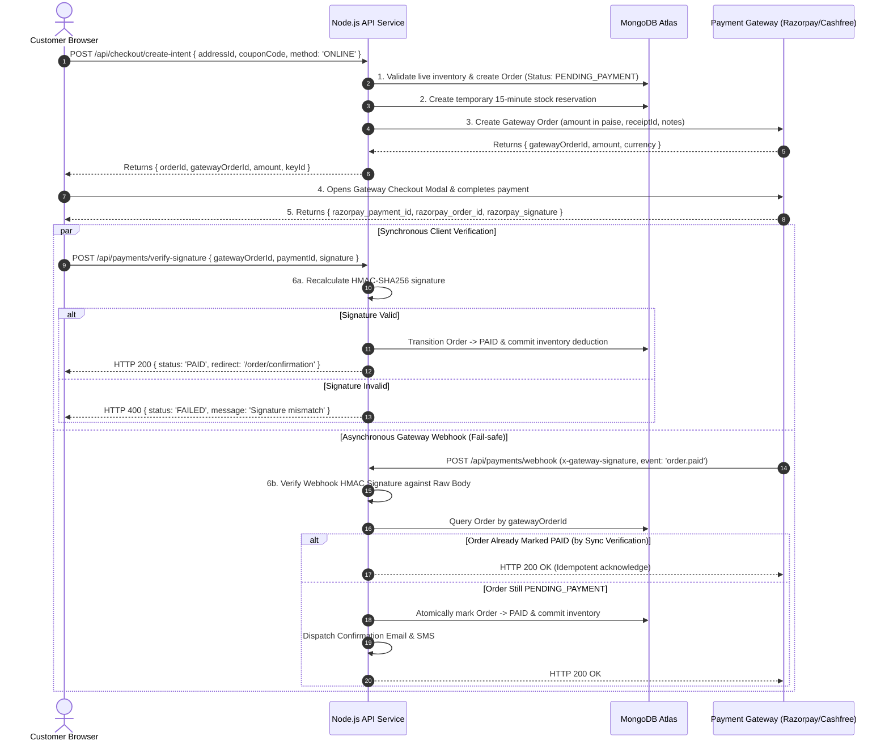
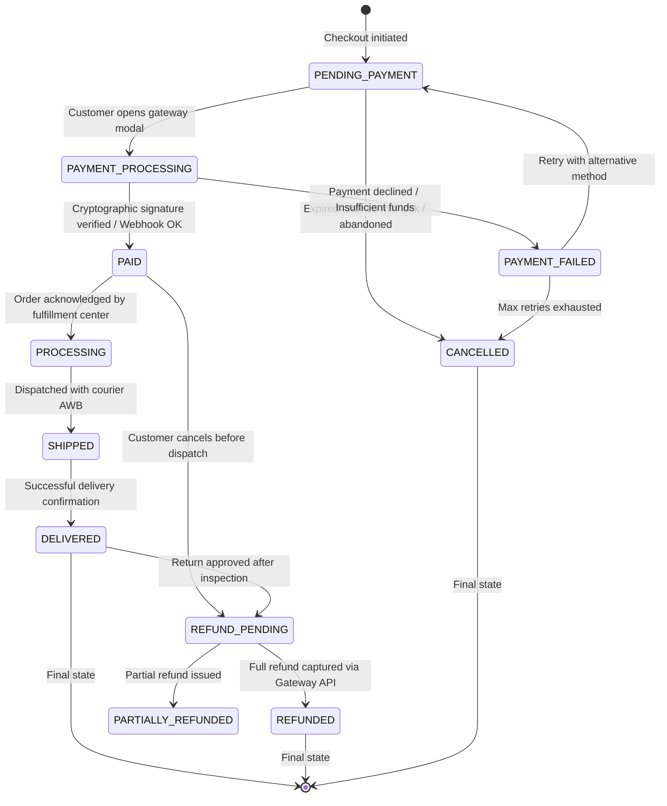

# AVEEZ FASHION — PAYMENT & FINANCIAL SETTLEMENT ARCHITECTURE

**Document Version:** 1.0.0  
**Phase:** Phase 0 — Architecture & System Planning  
**Payment Gateways:** Razorpay / Cashfree (Primary Indian Rails) + Stripe (Optional Future International)  
**Supported Payment Rails:** UPI (Intent & Collect), Credit/Debit Cards (Visa, Mastercard, RuPay), Net Banking, Wallets, and Cash on Delivery (COD)  

---

## 1. Core Financial Tenet: Zero Frontend Trust

The most critical principle in e-commerce payment architecture:
> **An order is NEVER marked as `PAID` based on frontend client confirmation.**

Frontend callbacks are vulnerable to client manipulation, browser closure, network dropouts, or man-in-the-middle tampering. Payment verification must be established via:
1. **Server-Side Cryptographic Signature Verification** (Synchronous path), AND/OR
2. **Asynchronous Cryptographic Webhook Delivery** (Asynchronous fail-safe source of truth).

---

## 2. Supported Payment Methods & Processing Rails

| Method | Primary Provider Rail | User Experience | Processing Time | Fraud/Risk Profile |
| :--- | :--- | :--- | :--- | :--- |
| **UPI (Intent)** | Razorpay / Cashfree | Opens GPay, PhonePe, Paytm directly on mobile device | Instant (< 3 seconds) | Lowest (Biometric 2FA) |
| **UPI (Collect / QR)** | Razorpay / Cashfree | Desktop displays QR / sends VPA request to phone | Instant (< 15 seconds) | Lowest |
| **Credit / Debit Cards** | RuPay, Visa, Mastercard via Gateway | 16-digit card input + RBI mandatory 2FA OTP | 15–30 seconds | Low (3D Secure 2.0) |
| **Net Banking** | Top 50+ Indian Banks | Redirects to bank portal for net banking authentication | 30–60 seconds | Extremely low |
| **Cash on Delivery (COD)** | Internal Verification Engine | Phone/SMS OTP verification prior to order confirmation | Post-delivery | Moderate (RTO risk handled via validation) |

---

## 3. End-to-End Payment Lifecycle & Architecture Flow



---

## 4. Payment & Order State Machine Specifications



### Detailed State Transitions:
1. **`PENDING_PAYMENT`**: Order draft created in database. Inventory reserved with an automated 15-minute TTL expiration.
2. **`PAYMENT_PROCESSING`**: Customer has initiated checkout modal; gateway transaction ID is linked.
3. **`PAID`**: Gateway signature verified or `order.paid` webhook processed. Stock reservation commits to permanent reduction.
4. **`PAYMENT_FAILED`**: Gateway reported transaction failure (e.g., incorrect OTP, card declined). Customer prompted with retry option.
5. **`CANCELLED`**: Customer voluntarily cancels order prior to shipping, or timeout releases inventory back to catalog.
6. **`REFUND_PENDING` / `REFUNDED` / `PARTIALLY_REFUNDED`**: Return or pre-dispatch cancellation approved; gateway refund API executed.

---

## 5. Signature Verification Implementation Formula

### 5.1 Callback Signature (Client Return)
When using Razorpay:
$$\text{Expected Signature} = \text{HMAC-SHA256}(\text{gatewayOrderId} + "|" + \text{gatewayPaymentId}, \text{KEY\_SECRET})$$

```typescript
import crypto from 'crypto';

export function verifyPaymentSignature(
  orderId: string,
  paymentId: string,
  receivedSignature: string,
  secret: string
): boolean {
  const generatedSignature = crypto
    .createHmac('sha256', secret)
    .update(`${orderId}|${paymentId}`)
    .digest('hex');

  // Use timingSafeEqual to prevent timing attacks
  return crypto.timingSafeEqual(
    Buffer.from(generatedSignature, 'utf-8'),
    Buffer.from(receivedSignature, 'utf-8')
  );
}
```

### 5.2 Webhook Signature (Gateway Notification)
The webhook endpoint requires raw request body bytes:
$$\text{Expected Signature} = \text{HMAC-SHA256}(\text{rawRequestBody}, \text{WEBHOOK\_SECRET})$$

```typescript
export function verifyWebhookSignature(
  rawBody: Buffer | string,
  receivedHeaderSignature: string,
  webhookSecret: string
): boolean {
  const expectedSignature = crypto
    .createHmac('sha256', webhookSecret)
    .update(rawBody)
    .digest('hex');

  return crypto.timingSafeEqual(
    Buffer.from(expectedSignature, 'utf-8'),
    Buffer.from(receivedHeaderSignature, 'utf-8')
  );
}
```

---

## 6. Cash on Delivery (COD) Architecture

COD accounts for a significant portion of Indian fashion retail, but carries Return to Origin (RTO) risks. The COD architecture introduces strict risk mitigations:

1. **Eligibility Restrictions:**
   * Maximum COD cart limit: ₹4,999 (prevents large fraudulent or abandoned bulk orders).
   * PIN code verification: Database cross-checks courier serviceability for COD cash collection.
2. **Two-Factor Phone Verification:**
   * Before a COD order enters `PROCESSING`, an automated 4-digit SMS/WhatsApp OTP is required to verify recipient intent.
3. **State Progression:**
   * Order initializes in state: `PENDING_CONFIRMATION`.
   * Upon phone OTP verification: Transitions to `CONFIRMED_COD` and moves directly to warehouse fulfillment.
   * On delivery: Courier updates delivery status, transitioning order to `PAID` upon cash collection.

---

## 7. Refund & Reversal Architecture

* **Pre-Dispatch Cancellation:** If an order in `PAID` state is cancelled before warehouse dispatch, the server initiates an instant refund via the Gateway Refund API:
  * Gateway API call: `POST /v1/payments/{paymentId}/refund` with `{ amount: originalAmount }`.
  * Status updates to `REFUNDED`; stock is automatically restored via `$inc: { "variants.$.stock": qty }`.
* **Post-Delivery Return:** Customer requests return within 7 days of delivery. Upon warehouse physical inspection and quality pass:
  * Admin dashboard approves return.
  * Server dispatches gateway refund to original payment source (UPI/Card) or provides store credit coupon.
* **Partial Refunds:** Supported for multi-item orders where one item was out of stock or returned individually.
