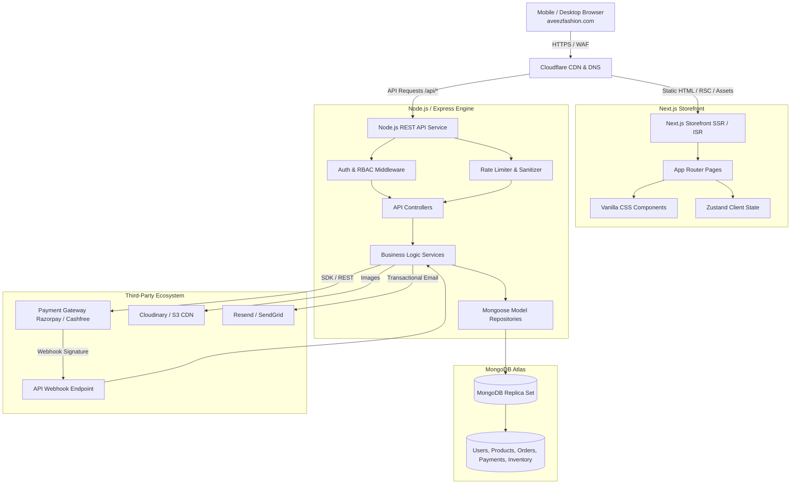
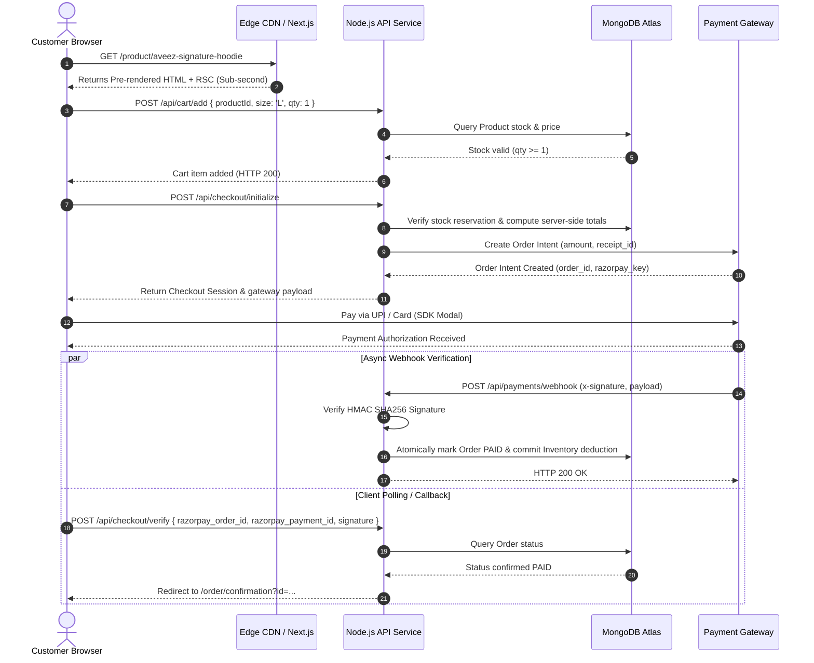
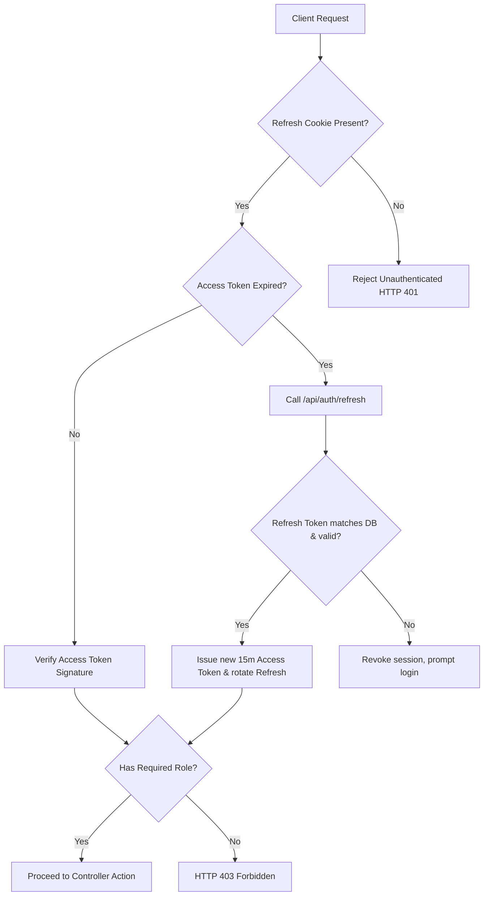
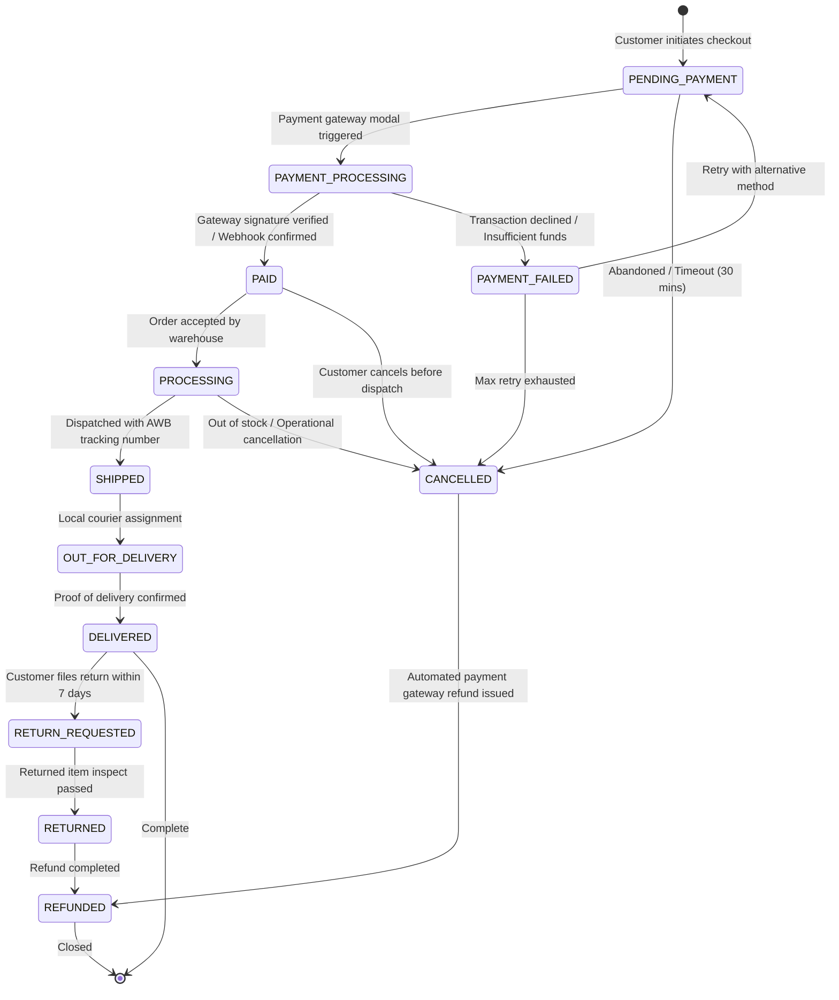

# AVEEZ FASHION — SYSTEM ARCHITECTURE SPECIFICATION

**Document Version:** 1.0.0  
**Phase:** Phase 0 — Architecture & System Planning  
**Brand:** AVEEZ FASHION  
**Production Domain:** `https://aveezfashion.com`  
**Target Industry:** Premium Fashion & Apparel E-commerce  

---

## 1. Executive Summary & Existing Repository Audit

### 1.1 Project Assessment

An exhaustive audit of the workspace (`e:\Aveezfashion`) was conducted prior to blueprinting:

| Assessment Dimension | Current Status | Technical Implications |
| :--- | :--- | :--- |
| **Existing Framework** | None (Clean slate / Greenfield) | Zero legacy debt; opportunity to enforce strict TypeScript, Next.js App Router, and modular design patterns from Day 1. |
| **Existing Folders** | Empty root directory | Directory scaffolding will follow domain-driven, maintainable boundaries. |
| **Existing Dependencies** | None | No dependency conflicts, obsolete packages, or bloated node modules. |
| **Existing Configuration** | None | Unified linting (`eslint`), formatting (`prettier`), and TypeScript strict-mode can be established uniformly. |
| **Existing Environment Files** | None | Environment segregation (`.env.example`, `.env.local`, `.env.production`) will be implemented cleanly with runtime validation (`zod`). |
| **Existing Assets / Logos** | None | Vector SVGs and optimized WebP/AVIF brand assets will be standardized with responsive dimensioning. |
| **Existing Code** | None | Complete architectural freedom without refactoring overhead. |
| **Existing Database Config** | None | MongoDB Atlas connection management, pooling, and Mongoose indexing will be constructed with production resilience. |

#### Architectural Assessment Breakdown:
* **WHAT ALREADY EXISTS:** Clean greenfield workspace root.
* **WHAT CAN BE REUSED:** N/A (no legacy code to salvage).
* **WHAT NEEDS TO BE REBUILT:** The full production stack: Next.js frontend storefront, Node.js REST API service layer, MongoDB data persistence layer, administrative management cockpit, secure payment gateway integrations, and background notification workers.
* **WHAT SHOULD BE REMOVED LATER:** N/A.
* **WHAT IS MISSING:** Complete codebase, configuration blueprints, design tokens, data models, API endpoints, payment webhooks, and deployment pipelines (all mapped across Phase 0 documentation).

---

## 2. Business Goals & Non-Functional Requirements

### 2.1 Core Business Goals
1. **High-Conversion Digital Storefront:** Deliver an ultra-smooth, high-speed mobile shopping experience for fashion-conscious buyers across India and globally.
2. **Reliable Checkout & Omnichannel Payments:** Support seamless UPI (Google Pay, PhonePe, Paytm), Credit/Debit Cards, Net Banking, and controlled Cash on Delivery (COD).
3. **Flawless Inventory Integrity:** Prevent overselling, double allocation, and phantom stock through atomic inventory reservations and transactional state transitions.
4. **Frictionless Back-Office Administration:** Provide an intuitive admin dashboard for catalog curation, SKU tracking, order fulfillment, coupon engine, and customer support.

### 2.2 Non-Functional Architectural Requirements
* **Performance:** Core Web Vitals targets: LCP < 1.8s, FID/INP < 100ms, CLS < 0.05. Static Generation (SSG) / Incremental Static Regeneration (ISR) for catalog pages.
* **Security:** OWASP Top 10 compliance, strict Content Security Policy (CSP), encrypted sessions via HTTP-Only Secure cookies, HMAC signature verification for payment callbacks, and zero client-side price trust.
* **Scalability:** Stateless API containers capable of horizontal scaling behind a reverse proxy/load balancer; CDN edge caching for static assets and image optimization.
* **Reliability:** 99.9% uptime target with automated health checks, database connection pooling, and circuit breaker patterns on third-party payment gateways.
* **SEO & Discoverability:** 100% server-rendered semantic HTML, Open Graph tags, canonical headers, and automated JSON-LD schema generation (Product, Breadcrumb, Organization).

---

## 3. Technology Stack Specification

```
┌────────────────────────────────────────────────────────────────────────┐
│                        AVEEZ FASHION TECH STACK                         │
├───────────────────┬────────────────────────────────────────────────────┤
│ Layer             │ Technologies Selected                              │
├───────────────────┼────────────────────────────────────────────────────┤
│ Frontend Web App  │ Next.js 14+ (App Router), React 18/19, TypeScript  │
│ UI & Styling      │ Vanilla CSS Modules, CSS Custom Properties (Tokens)│
│ State Management  │ React Context + Zustand (Lightweight, Selective)   │
│ Backend Service   │ Node.js (LTS), Express.js REST API / Clean Service │
│ Validation        │ Zod (Runtime Schema Validation across Client & API)│
│ Database Layer    │ MongoDB 7.0+, Mongoose 8+ ODM                       │
│ Caching & Queue   │ In-Memory TTL Cache / Upstash Redis (Future Scale) │
│ Payment Gateways  │ Razorpay / Cashfree (UPI, Cards, NetBanking, COD)  │
│ Authentication    │ JWT (Access/Refresh Tokens), bcryptjs, HTTP-only   │
│ Media Storage     │ Cloudinary CDN / AWS S3 (WebP/AVIF transforms)     │
│ Transactional Mail│ Resend / Nodemailer (SMTP Failover)                │
│ Deployment Target │ Vercel (Frontend Edge) + VPS / Render (API Service)│
└───────────────────┴────────────────────────────────────────────────────┘
```

---

## 4. High-Level System Architecture



---

## 5. Detailed Layer Architectures

### 5.1 Frontend Architecture (Next.js & React)
* **App Router Scaffolding:** Separates public customer storefront (`(store)`) from authenticated accounts (`(customer)`) and administrative cockpit (`(admin)`).
* **Rendering Strategy:**
  * **Static Site Generation (SSG) / ISR:** Homepage, Category landing pages, and Product Detail Pages (PDP) regenerate with an incremental revalidation window (e.g., 60 seconds), ensuring instantaneous global delivery from edge caches.
  * **Server-Side Rendering (SSR):** Search results and personalized product recommendations.
  * **Client Components (`'use client'`):** Restricted strictly to interactive leaves: Cart drawer, Checkout forms, Wishlist toggle buttons, Image zoom carousels, and Admin data tables.
* **State Management Architecture:**
  * **Server State:** Managed via Next.js server actions and React cache tags.
  * **Client State (Zustand):** Lightweight stores for ephemeral client state: `cartStore` (persisted to `localStorage` with server hydration reconciliation), `uiStore` (modals, search drawers, toasts), and `authStore` (user identity state).

### 5.2 Backend Architecture (Node.js REST API)
* **Layered Clean Architecture:**
  * **Router Layer (`/routes`):** Declares HTTP paths, route-level middlewares, and rate limits.
  * **Validator Layer (`/validators`):** Zod schemas intercepting incoming payload bodies, query parameters, and route parameters.
  * **Controller Layer (`/controllers`):** Extracts parsed parameters, passes payload to domain services, formats standardized JSON responses (`{ success: true, data, meta }`).
  * **Service Layer (`/services`):** Houses pure business logic, pricing computations, coupon validation rules, and inventory reservation algorithms.
  * **Data Access Layer (`/models`):** Mongoose schemas enforcing schema-level constraints, custom validators, pre/post middleware hooks, and compound indexes.

```
Request ──> Express Router ──> RateLimiter ──> AuthMiddleware ──> ZodValidator 
        ──> Controller ──> Domain Service ──> Mongoose Model ──> MongoDB 
        ──> Standardized Response
```

### 5.3 Database Architecture (MongoDB)
* **Connection Pooling:** Configures `maxPoolSize: 50`, `minPoolSize: 10`, `serverSelectionTimeoutMS: 5000` to prevent socket starvation under burst traffic.
* **Data Modeling Paradigm:**
  * **Hybrid Modeling:** Denormalizes snapshot data on mutable records (e.g., embedding customer shipping address and purchased item pricing/names directly into `orders` so historical records remain immutable even if the product or user address changes later).
  * **Atomic Operations:** Uses MongoDB `$inc`, `$set`, and multi-document transactions (`session.startTransaction()`) exclusively for order creation, inventory deduction, and payment capture reconciliation.

---

## 6. Request Lifecycle & Communication Flow



---

## 7. Authentication & Authorization Architecture

### 7.1 Multi-Tier User Structure
1. **Public Guest:** Anonymous session identifier stored in browser cookie for cart association prior to authentication.
2. **Authenticated Customer:** Registered buyer possessing JWT-based session with access to orders, addresses, and wishlist.
3. **Staff / Admin Roles:**
   * `SUPER_ADMIN`: Unrestricted master privileges (financials, settings, user management).
   * `STORE_MANAGER`: Catalog management, inventory updates, review moderation.
   * `ORDER_OPERATOR`: Order fulfillment, shipping label generation, tracking updates.

### 7.2 Token & Session Strategy
* **Access Token:** Short-lived JWT (15-minute expiration) signed with `RS256` or `HS256` containing `userId`, `role`, and `tokenVersion`.
* **Refresh Token:** Long-lived cryptographically secure random token (7-day sliding expiration), stored in an **`HttpOnly`, `Secure`, `SameSite=Strict` cookie**, with a hashed counterpart persisted in the database.
* **Token Invalidation:** Modifying passwords or initiating a global logout increments the user's `tokenVersion`, instantly invalidating all outstanding access tokens.



---

## 8. Checkout & Payment Architecture

### 8.1 Zero-Trust Financial Model
* **Rule 1: Client Prices Are Advisory Only.** The client passes only `productId`, `variantId`, `quantity`, and `couponCode`. The server executes fresh database lookups for base prices, active promotional discounts, tax calculations, and shipping fee schedules.
* **Rule 2: Two-Step Order Creation & Payment Reconciliation.**
  1. **Order Initialization (`PENDING_PAYMENT`):** Server validates stock, applies promo codes, creates an internal order record, and generates the payment gateway order ID.
  2. **Payment Verification (`PAID`):** An order is NEVER marked as `PAID` until cryptographic HMAC SHA256 signature verification passes either via the synchronous callback or asynchronous gateway webhook.
* **Rule 3: Webhook Asynchronous Source of Truth.** If a customer closes their mobile browser immediately after payment, the gateway webhook delivers the signed settlement notification, reconciles the database state, decrements real stock, and triggers confirmation emails.

---

## 9. Order Lifecycle State Machine



---

## 10. Administrative Cockpit Architecture

* **Isolated Subsystem:** Administrative routes sit under protected middleware (`/api/admin/*`) and dedicated Next.js route groups (`app/(admin)/*`).
* **Audit Trail Logging:** Every privileged action (price change, order status override, refund trigger, coupon generation) writes an immutable record to the `audit_logs` collection detailing `adminId`, `action`, `resourceId`, `oldValue`, `newValue`, and `ipAddress`.
* **Zero Accidental Overwrites:** Optimistic concurrency control via version keys (`__v`) prevents two store managers from simultaneously overwriting inventory numbers.

---

## 11. Media, File Storage & CDN Architecture

* **Cloud Image Pipeline:** Uploaded raw images (product photography, lookbooks, banners) are routed through Cloudinary or AWS S3 with an Image Optimization CDN pipeline.
* **Automated Transformations:**
  * Master original preserved intact.
  * Auto-conversion to modern formats: `f_auto` (AVIF > WebP > JPEG fallback).
  * Auto-compression: `q_auto:good` (visual fidelity optimized for fashion textiles).
  * Breakpoint pre-generation: Thumbnail (`300x400`), Card (`600x800`), Zoom HD (`1500x2000`).
* **Security:** Uploads are authorized via temporary backend-signed upload presets; client applications never receive persistent read/write cloud credentials.

---

## 12. Email & Customer Communication Architecture

* **Transactional Email Engine:** Powered by Resend / SendGrid with DKIM, SPF, and DMARC verification configured on `aveezfashion.com`.
* **Automated Trigger Matrix:**
  * `ORDER_CONFIRMATION`: Triggered upon `PAID` state transition with itemized HTML receipt and delivery SLA.
  * `ORDER_SHIPPED`: Triggered on AWB assignment with live courier tracking link.
  * `ORDER_DELIVERED`: Triggered on courier delivery ping; requests verified buyer product review.
  * `PASSWORD_RESET`: Cryptographic 15-minute expiring link.
* **Queue Decoupling:** Email dispatches are processed asynchronously via non-blocking background workers or micro-queues to prevent user request latency.

---

## 13. Search & Catalog Discovery Architecture

* **Phase 1-2 Implementation:** High-performance MongoDB compound indexes:
  * Text index across `title`, `description`, `tags`, and `category`.
  * Filter index across `gender`, `categorySlug`, `price`, `sizes`, `inStock`, and `createdAt`.
* **Facet Aggregation Engine:** Single-pass MongoDB `$facet` aggregation pipelines retrieve both the paginated product dataset and real-time faceted counts (e.g., matching colors, available sizes, price min/max).
* **Future Elasticity:** Designed with an abstraction layer (`SearchService`) allowing plug-and-play migration to Meilisearch or Algolia when catalog size exceeds 10,000 SKUs without touching controller or frontend code.

---

## 14. SEO & Metadata Architecture

* **Dynamic Metadata Generation:** Leverages Next.js `generateMetadata` on dynamic product routes to inject customized titles, descriptions, canonical links, and Open Graph previews.
* **Structured Data (JSON-LD):**
  * `Product` Schema: Injects `name`, `image`, `description`, `sku`, `brand` (Aveez Fashion), `offers` (`price`, `priceCurrency: INR`, `availability`, `itemCondition`).
  * `BreadcrumbList` Schema: Reflects the navigational hierarchy (`Home > Women > Dresses > Evening Wear`).
  * `Organization` Schema: Encapsulates official brand details, social URLs, and customer care contact points.
* **Robots & Sitemaps:** Automated XML sitemap generation at `/sitemap.xml` with indexation priority and daily revalidation frequency for active catalog items.

---

## 15. Analytics, Observability & Error Handling

* **Customer Privacy First:** Cookie consent banner gating non-essential tracking.
* **E-commerce Telemetry:** Standardized Google Analytics 4 (GA4) Enhanced E-commerce event schema (`view_item_list`, `view_item`, `add_to_cart`, `begin_checkout`, `purchase`).
* **Server-Side Observability:**
  * Centralized logging via Winston/Pino with structured JSON format (`timestamp`, `level`, `correlationId`, `endpoint`, `durationMs`).
  * Unhandled exception traps, promise rejection listeners, and health check probes (`/health/liveness`, `/health/readiness`).

---

## 16. Scalability & Cost-Efficiency Strategy

* **Bootstrap-to-Scale Trajectory:**
  * **Stage 1 (Launch / < 10,000 monthly visitors):** Next.js on Vercel Hobby/Pro + Single Node.js API on managed VPS / Render ($7-$25/mo) + MongoDB Atlas M0/M10 ($0-$57/mo). Total footprint is minimal, robust, and cost-effective.
  * **Stage 2 (Growth / 100,000+ monthly visitors):** Containerized Node.js API deployed with horizontal auto-scaling (2-5 replicas), Upstash Redis for distributed session caching and rate-limiting, and Cloudflare CDN caching full catalog responses at edge PoPs.

---

## 17. Architecture Verification & Sign-off Checklist

- [x] Clear separation between client presentation, API orchestration, and persistent storage.
- [x] Zero financial trust placed on client-supplied data.
- [x] Cryptographic verification required for all payment and authentication lifecycles.
- [x] Database schemas planned with atomic updates for inventory and transactional consistency.
- [x] Mobile-first, performance-centric rendering patterns specified.
- [x] Complete alignment with startup lean economics without vendor lock-in.
